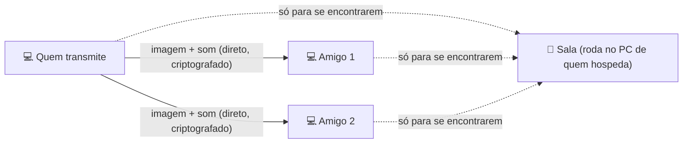
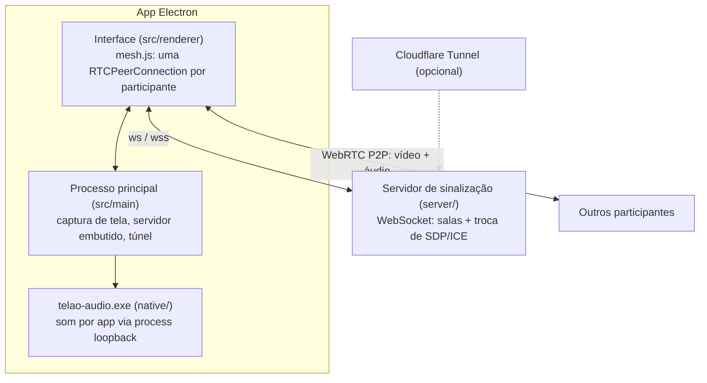

<div align="center">


# Telão

**Compartilhe a tela com seus amigos, com som, direto de PC para PC.**

Escolha a tela ou a janela, a resolução, o FPS e a qualidade.
O som do **Discord não vai junto**, então ninguém ouve a própria voz de volta.

[Como conseguir o Telão](#-como-conseguir-e-abrir-o-telão) ·
[Início rápido](#-início-rápido) ·
[Passo a passo](#-passo-a-passo) ·
[Problemas comuns](#-problemas-comuns)

</div>

> [!IMPORTANT]
> - **O Telão não tem chat de voz.** Ele transmite a tela e o som do computador. Para conversar,
>   fiquem numa chamada do Discord (ou de outro app) ao mesmo tempo. O som dessa chamada não entra
>   na transmissão.
> - **Netflix, Prime Video, Disney+ e outros streamings pagos aparecem PRETOS** para quem assiste,
>   por proteção contra cópia. YouTube, vídeos baixados e jogos funcionam.

---

## Índice

- [O que o Telão faz](#-o-que-o-telão-faz)
- [O que você precisa](#-o-que-você-precisa)
- [Como conseguir e abrir o Telão](#-como-conseguir-e-abrir-o-telão)
- [Início rápido](#-início-rápido)
- [Passo a passo](#-passo-a-passo)
  - [1. Criar uma sala (quem hospeda)](#1-criar-uma-sala-quem-hospeda)
  - [2. Entrar numa sala (os amigos)](#2-entrar-numa-sala-os-amigos)
  - [3. Transmitir a sua tela](#3-transmitir-a-sua-tela)
  - [4. Assistir a tela dos outros](#4-assistir-a-tela-dos-outros)
  - [5. Mudar as cores do app](#5-mudar-as-cores-do-app)
- [Som: como o Discord fica de fora](#-som-como-o-discord-fica-de-fora)
- [Qualidade, FPS e internet](#-qualidade-fps-e-internet)
- [Conectando pela internet](#-conectando-pela-internet)
- [Problemas comuns](#-problemas-comuns)
- [Perguntas frequentes](#-perguntas-frequentes)
- [Privacidade e segurança](#-privacidade-e-segurança)
- [Para desenvolvedores](#-para-desenvolvedores)

---

## ✨ O que o Telão faz

- **Transmite a tela inteira ou só uma janela** (um jogo, o navegador, um vídeo…).
- **Vai com o som do computador, mas sem o som do Discord** e de outros apps de voz (TeamSpeak, Teams,
  Zoom, Skype, WhatsApp…).
- **Você escolhe a qualidade:** resolução de 480p a nativa, de 5 a 60 FPS, bitrate e codec, e pode
  mudar tudo **durante** a transmissão.
- **Várias pessoas podem transmitir ao mesmo tempo**, e todo mundo vê todas as telas.
- **Vai direto de PC para PC:** a imagem e o som não passam por nenhum servidor de terceiros.
- **Dá para escolher as cores do app:** tema escuro, claro ou igual ao do Windows, e a cor de destaque.
- **Sem cadastro e sem mensalidade.** Um amigo cria a sala, manda um convite e pronto.

### Como funciona, em uma imagem



A "sala" só serve para os computadores se encontrarem. Depois disso, a imagem e o som vão
**direto** de um PC para o outro. Isso é o que se chama de conexão P2P.

---

## 💻 O que você precisa

- **Windows 10 ou Windows 11, 64 bits.** O filtro que tira o som do Discord precisa do Windows 10
  versão 2004 (de 2020) ou mais nova. Para ver sua versão, aperte `Win + R`, digite `winver` e dê Enter.
- **Internet.** Para assistir, qualquer uma serve. Para **transmitir**, o que importa é o **upload**,
  a velocidade de **envio** da sua internet, que costuma ser bem menor que a de download
  ([veja a tabela](#quanto-de-internet-a-transmissão-usa)).
- **Nenhuma conta.** Não precisa se cadastrar em nada.

---

## 📥 Como conseguir e abrir o Telão

### 1. Pegue o arquivo

O Telão vem em dois sabores (~110 MB cada). Use **um** deles:

| Arquivo | Quando usar |
|---|---|
| `Telao-<versão>-portable.exe` | **Mais fácil.** Não instala nada: é só abrir. Ideal para quem vai mais assistir. Demora uns segundos para abrir. |
| `Telao-Setup-<versão>.exe` | **Instalador.** Cria atalho no menu Iniciar e abre mais rápido. Recomendado para **quem vai hospedar a sala**. |

Normalmente, **quem te convidou manda o arquivo** (por Google Drive, WeTransfer etc.). Se você tem
acesso a este repositório no GitHub, também pode baixar na página de **Releases**, na parte **Assets**
da versão mais recente. Ali, não baixe o "Source code": ele é o código, não o programa.

### 2. Se o navegador avisar ao baixar

Programas novos e sem assinatura digital paga costumam gerar avisos. **Só siga os passos abaixo com o
arquivo que veio de alguém que você conhece.** Nunca faça isso com um `.exe` recebido de estranhos.

- **Edge:** aparece "*… não é baixado com frequência*". Clique nos **três pontinhos (…)** → **Manter**
  → **Mostrar mais** → **Manter mesmo assim**.
- **Chrome:** abra os downloads e escolha **Manter** (ou **Baixar arquivo suspeito**).

### 3. Abra o arquivo

Na primeira vez, o Windows mostra a tela azul "**O Windows protegeu o computador**" (SmartScreen).
Ela deve mostrar **Editor desconhecido** e o nome do arquivo do Telão. Para abrir:

1. Clique em **Mais informações**.
2. Clique em **Executar assim mesmo**.

No **instalador**:

- Em "**Para quem esta aplicação deve ser instalada?**", deixe **Apenas para mim** (já vem marcado).
  Assim não precisa de senha de administrador.
- Na tela da pasta, não mude nada e clique em **Instalar**.

> [!NOTE]
> Se aparecer "**O Controle Inteligente de Aplicativos bloqueou…**" (Windows 11), o Windows está
> barrando todo app sem assinatura digital, e não dá para liberar só o Telão. Desligar esse controle
> é uma decisão sua: fica em **Segurança do Windows → Controle de aplicativos e do navegador**. Leia o
> aviso do Windows antes.

### Se o antivírus barrar

O sintoma costuma ser o arquivo **sumir** da pasta Downloads, ou aparecer um aviso da Segurança do
Windows. Alguns antivírus desconfiam de qualquer programa novo sem assinatura (o chamado "falso
positivo").

- **Nunca desative o antivírus.** Libere **só este arquivo**, e só se ele veio de quem você confia.
- **Microsoft Defender (o padrão do Windows):** Iniciar → **Segurança do Windows** → **Proteção contra
  vírus e ameaças** → **Histórico de proteção** → clique no item do Telão → **Ações** → **Restaurar**
  (ou **Permitir no dispositivo**).
- **Outros antivírus:** procure por "Quarentena" e "Exceções".
- Se o antivírus apontar um vírus **com nome específico**, não libere e avise quem te mandou.

**Para conferir se o arquivo é o original**, compare a impressão digital (SHA-256) com a que está nas
notas da versão (ou peça a quem te mandou). No Prompt de Comando:

```
certutil -hashfile "%USERPROFILE%\Downloads\Telao-1.1.0-portable.exe" SHA256
```

Troque o nome pelo arquivo que você baixou. Se o código for diferente, não abra.

---

## 🚀 Início rápido

**Quem cria a sala (só uma pessoa):**

1. Abra o Telão, digite seu nome e escolha **Hospedar neste PC**. A sala já ganha um nome sozinha,
   mas você pode trocar.
2. Clique em **Criar sala e entrar**. Se o Windows perguntar sobre o Firewall, clique em **Permitir acesso**.
3. **Só na primeira vez:** no painel **Convidar amigos**, em **Pela internet**, clique em
   **Baixar e criar link** e espere o link aparecer.
4. Clique no botão de copiar ao lado do link **Pela internet** e mande para os amigos. O convite
   **já inclui o nome da sala**, algo como `wss://palavras-aleatorias.trycloudflare.com/sala-k3x9q2a`.
   Se você pôs senha, mande a senha também.
5. Espere uns 10 a 30 segundos antes de o pessoal entrar (o link demora um pouquinho para funcionar).
   **Não feche o Telão** enquanto o pessoal estiver usando: isso encerra a sala.

**Os amigos:**

1. Abram o Telão, digitem o nome e escolham **Entrar em um servidor**.
2. Colem o convite em **Endereço do servidor**. O campo **Sala** é preenchido sozinho.
3. Se quem hospeda pôs senha, digitem em **Senha do servidor**.
4. Cliquem em **Entrar na sala**.

**Para transmitir:** clique em **Compartilhar tela**, escolha a tela ou a janela e clique em **Transmitir**. 🎉

---

## 📖 Passo a passo

### 1. Criar uma sala (quem hospeda)

Uma pessoa do grupo "hospeda" a sala. O computador dela vira o ponto de encontro, e ela precisa
**ficar com o Telão aberto** enquanto todos estiverem usando.

Na tela inicial:

| Campo | O que colocar |
|---|---|
| **Seu nome** | Como os outros vão te ver (até 32 letras). |
| **Sala** | O nome da sala. O app já sorteia um difícil de adivinhar (como `sala-k3x9q2a`), mas você pode escrever outro, como `filme-sexta`. O botão 🔀 sorteia outro. Maiúsculas e minúsculas não importam. |
| **Hospedar neste PC** | Selecione esta opção. |
| **Porta** | Deixe `47800`. Só mude se o app avisar que a porta já está em uso. |
| **Senha** *(opcional)* | Se colocar, os amigos vão precisar dela. O app não guarda senhas: digite de novo a cada vez. |
| **Criar link público pela internet** | Deixe **marcado** se algum amigo estiver em outra casa. |

Clique em **Criar sala e entrar**.

**Aviso do Firewall do Windows:** na primeira vez, o Windows pode perguntar se o Telão pode usar a
rede. Clique em **Permitir acesso**. Sem isso, quem entra pela mesma rede (ou por VPN de jogos) não
consegue chegar até você. Quem entra pelo link da internet não depende disso. Se você clicou em
**Cancelar**, veja [Cliquei em Cancelar no aviso do Firewall](#cliquei-em-cancelar-no-aviso-do-firewall).

Na direita aparece o painel **Convidar amigos**. Cada endereço é um **convite**: ele já leva o nome
da sala, e tem um botão de copiar ao lado.

- **Pela internet:** um link como `wss://palavras-aleatorias.trycloudflare.com/sala-k3x9q2a`. Serve
  para **qualquer pessoa, de qualquer lugar**.
  - **Na primeira vez**, aparece o botão **Baixar e criar link**. O link usa um programa gratuito da
    Cloudflare chamado `cloudflared` (~60 MB), que o Telão baixa do GitHub oficial da Cloudflare e
    guarda para as próximas vezes.
  - O link **muda toda vez** que você cria a sala. Mande o novo a cada vez.
  - Ele pode levar **alguns segundos** para começar a funcionar depois de aparecer.
- **Na mesma rede (Wi-Fi ou cabo):** algo como `192.168.0.10:47800/sala-k3x9q2a`. Serve para quem
  está na **mesma casa/rede** que você.
  - Aparece um endereço para cada placa de rede do PC, com o nome da placa em cima. Mande o da placa
    **Wi-Fi** ou **Ethernet** (normalmente começa com `192.168.` ou `10.`).
  - Placas de VPN aparecem no fim da lista: no Radmin VPN o endereço começa com `26.`, no Tailscale
    com `100.`. Elas só servem para quem está na mesma VPN.
  - Placas de máquinas virtuais (VirtualBox, VMware, WSL, "vEthernet") não servem.

> **Se você sair da sala ou fechar o Telão, a sala acaba** para todo mundo. Ao clicar em **Sair**
> com gente na sala, o app pede confirmação. Fechar a janela encerra direto.

### 2. Entrar numa sala (os amigos)

Na tela inicial:

| Campo | O que colocar |
|---|---|
| **Seu nome** | Como os outros vão te ver. |
| **Entrar em um servidor** | Selecione esta opção. |
| **Endereço do servidor** | Cole o **convite** que recebeu. Ao colar, o campo **Sala** é preenchido sozinho. |
| **Sala** | Já vem do convite. Se você recebeu só o endereço, sem a sala no fim, digite o nome que quem hospeda mandou. |
| **Senha do servidor** | Só se quem hospeda tiver colocado uma. |

Clique em **Entrar na sala**.

Dentro da sala, a lista **Participantes** mostra quem está lá e como está a conexão com cada um:

| Etiqueta | Significado |
|---|---|
| `conectando…` | Os dois computadores ainda estão se encontrando (normalmente leva 1 a 3 segundos). |
| `conectado` | Conectou. Em seguida a etiqueta mostra o tipo de conexão. |
| `rede local` | Conexão direta pela mesma rede. A melhor possível. |
| `P2P direto` | Conexão direta pela internet. Ótima. |
| `via TURN` | A conexão passa por um servidor intermediário (só existe se alguém configurou um). Funciona, com um pouco mais de atraso. |
| `falhou` | Não deu para conectar com essa pessoa. Veja [Problemas comuns](#participante-fica-em-conectando-ou-falhou). |
| `AO VIVO` | É você, transmitindo. |

O app lembra seu nome, a sala e o endereço para a próxima vez. As senhas ele não guarda.

### 3. Transmitir a sua tela

1. Clique em **Compartilhar tela** (o botão colorido no alto).
2. Escolha o que transmitir:
   - **Telas inteiras:** tudo o que aparece no monitor. Se você tem dois monitores, aparecem os dois,
     e o principal vem marcado como "principal".
   - **Janelas:** só uma janela, como o jogo, o navegador ou o player de vídeo. O resto da sua tela
     fica escondido.
   - Se a janela que você quer não aparecer, clique em **Atualizar**.
3. **Som:** deixe **Transmitir som** marcado. O menu ao lado já vem na opção certa ("Todos os apps, menos os
   excluídos" para tela inteira; "Só o app desta janela" para janela). Só mexa se precisar; os
   detalhes estão em [Som](#-som-como-o-discord-fica-de-fora).
4. Clique em **Transmitir** (ou dê dois cliques na tela ou janela escolhida).

Enquanto você transmite, o painel **Sua transmissão** (à direita) mostra:

- uma **prévia** do que está indo para os outros;
- **quais apps estão no som** e quais ficaram de fora ("Fora da transmissão: Discord");
- um **medidor de som**: a barra verde se mexe quando tem som saindo;
- os **ajustes de qualidade**, que você pode mudar a qualquer momento ([explicação](#-qualidade-fps-e-internet));
- **Enviando para cada pessoa**: a resolução, o FPS e a velocidade que cada amigo está recebendo de verdade.

Botões:

- **Trocar tela:** muda o que está sendo transmitido, sem parar.
- **Parar** (ou **Parar transmissão**, no alto): encerra a sua transmissão.

> Pode minimizar o Telão enquanto transmite a **tela inteira**. Mas se estiver transmitindo
> **uma janela**, não minimize **essa janela**: o Windows para de desenhar janelas minimizadas,
> e os outros veriam a imagem congelada.

### 4. Assistir a tela dos outros

Quando alguém transmite, a tela da pessoa aparece no meio do Telão. Se várias pessoas transmitirem,
as telas ficam lado a lado.

Passe o mouse sobre a tela de alguém para ver os controles:

| Controle | O que faz |
|---|---|
| 🔊 | Liga e desliga o som dessa pessoa. |
| Barra de volume | Volume só dessa pessoa. |
| ⓘ | Mostra os detalhes: resolução, FPS, velocidade, codec, pacotes perdidos e o tempo de resposta (ms). |
| ⛶ | Tela cheia. **Dois cliques** na imagem também abrem e fecham a tela cheia. `Esc` sai. |

Enquanto você assiste ou transmite, o Telão impede que o monitor apague sozinho.

### 5. Mudar as cores do app

Clique no botão de **paleta** 🎨: ele fica no canto da tela inicial e no alto da sala, ao lado de
**Compartilhar tela**. Na janela **Aparência**:

- **Tema:** **Escuro** (o padrão), **Claro** ou **Igual ao Windows**. Esta última opção acompanha o
  modo claro ou escuro do Windows sozinha.
- **Cor de destaque:** a cor dos botões, das seleções e do logo. São 9 cores prontas, ou clique em
  **Outra cor…** para escolher qualquer uma.
- **Restaurar o padrão:** volta para tema escuro com azul.

As mudanças valem na hora e ficam salvas neste computador. Pode escolher à vontade: o app ajusta a
cor do texto dos botões sozinho (branco ou preto) para continuar legível, inclusive com cores claras
como o amarelo. As telas transmitidas continuam com fundo preto em qualquer tema, porque são vídeo.

---

## 🔊 Som: como o Discord fica de fora

O Telão captura o som **app por app**, com a mesma técnica que o OBS usa na captura de áudio por
aplicativo. Por isso dá para escolher o que entra e o que fica de fora.

| Opção | O que vai junto | Padrão para |
|---|---|---|
| **Todos os apps, menos os excluídos** | Tudo o que toca no PC (jogo, música, vídeo…), **menos** os apps da lista de excluídos e o próprio Telão. | Tela inteira |
| **Só o app desta janela** | Só o som do programa daquela janela. | Janela |
| **Tudo, sem filtro (inclui Discord)** | Todo o som do PC, **inclusive** chamadas de voz. Use só se o filtro não estiver funcionando. Nesse modo, o som dos outros participantes fica mudo enquanto você transmite, para não dar eco. | — |

### A lista de excluídos

Clique em **Apps excluídos** na janela de escolha da tela para ver e editar a lista. Por padrão ela já tem:

`Discord.exe` · `DiscordPTB.exe` · `DiscordCanary.exe` · `DiscordDevelopment.exe` ·
`TeamSpeak.exe` · `ts3client_win64.exe` · `ts3client_win32.exe` · `ms-teams.exe` · `Teams.exe` ·
`Zoom.exe` · `Skype.exe` · `WhatsApp.exe` · `Telegram.exe` · `slack.exe` · `mumble.exe` ·
`Guilded.exe` · `Element.exe` · `Signal.exe`

- Coloque **um programa por linha**, com o nome do arquivo `.exe`. Para descobrir o nome de um
  programa, abra o **Gerenciador de Tarefas** (`Ctrl + Shift + Esc`), vá em **Detalhes** e veja a
  coluna "Nome".
- **Restaurar a lista padrão** volta para a lista acima.
- Os processos "filhos" de um app excluído também ficam de fora.

### Como conferir se está funcionando

Durante a transmissão, olhe o painel **Sua transmissão**:

- "**Som dos apps:** Spotify, chrome" lista os apps cujo som **está indo**.
- "**Fora da transmissão:** Discord" lista os que **foram barrados**.
- O **medidor verde** mostra o som saindo. Peça para alguém falar no Discord enquanto nada mais
  toca: o medidor deve ficar **parado**.

### Limitações do filtro

- **Discord aberto no navegador** (discord.com no Chrome, Edge ou Opera): o som dele é o som do
  navegador e não dá para separar. Use o **aplicativo** do Discord.
- **Transmitindo uma janela de navegador:** vai o som de **todas as abas** daquele navegador.
- Alguns apps da Microsoft Store desenham a janela num processo separado. Se "Só o app desta janela"
  ficar sem som num desses, use **Todos os apps, menos os excluídos**.
- No **Windows 10 anterior à versão 2004**, a escolha de som e a lista de excluídos nem aparecem: vai
  todo o som do PC, inclusive o Discord, e o som dos outros fica mudo enquanto você transmite.

---

## 🎬 Qualidade, FPS e internet

Os ajustes ficam no painel **Sua transmissão**, à direita. Valem só para a **sua** transmissão:
mude **antes** de começar ou **durante**, e quem assiste vê a mudança em segundos.

| Ajuste | Opções | Dica |
|---|---|---|
| **Resolução** | 480p · 720p (HD) · 1080p (Full HD) · 1440p (2K) · Nativa (sem reduzir) | 1080p é o melhor equilíbrio. "Nativa" usa a resolução do seu monitor. |
| **Quadros/s (FPS)** | 5 · 10 · 15 · 24 · 30 · 45 · 60 | 60 para jogos. 30 para vídeos. 10–15 para textos e planilhas. |
| **Bitrate máximo** | Automático · 1 a 40 Mb/s | O **bitrate** é quanto de dados por segundo o vídeo usa: mais bitrate = imagem melhor, mas gasta mais internet. "Automático" calcula pela resolução e pelo FPS. |
| **Otimizar para** | Movimento · Nitidez | **Movimento** (jogos, vídeos) mantém a fluidez e perde nitidez se a internet apertar. **Nitidez** (texto, código) mantém as letras legíveis e perde FPS. |
| **Codec de vídeo** | Automático · H.264 · VP8 · VP9 · AV1 | O **codec** é o jeito de comprimir o vídeo. Na dúvida, deixe **Automático**. **H.264** usa a placa de vídeo e alivia o processador, bom para jogos. VP9 e AV1 dão imagem melhor, mas pesam no processador. |

O padrão é **1080p, 30 FPS, bitrate automático, Movimento, codec automático**.

### Sugestões prontas

| Para… | Resolução | FPS | Otimizar para | Codec | Bitrate |
|---|---|---|---|---|---|
| 🎮 Jogos | 1080p | 60 | Movimento | H.264 | Automático |
| 📺 YouTube, vídeos baixados | 1080p | 30 | Movimento | Automático | Automático |
| 💻 Código, textos, planilhas | Nativa | 15 | Nitidez | Automático | Automático |
| 🐢 Internet fraca | 720p | 30 | Movimento | H.264 | 2 ou 3 Mb/s |

### Quanto de internet a transmissão usa

No P2P, **quem transmite envia uma cópia para cada pessoa assistindo**. Por isso, o que pesa é o
**upload** de quem transmite. Quem só assiste usa pouco.

Valores máximos com bitrate **automático** em "Movimento":

| Qualidade | 1 pessoa assistindo | 2 pessoas | 3 pessoas | 4 pessoas |
|---|---|---|---|---|
| 720p · 30 FPS | 2,8 Mb/s | 5,5 Mb/s | 8,3 Mb/s | 11 Mb/s |
| 1080p · 30 FPS | 6,2 Mb/s | 12 Mb/s | 19 Mb/s | 25 Mb/s |
| 1080p · 60 FPS | 12 Mb/s | 25 Mb/s | 37 Mb/s | 50 Mb/s |
| 1440p · 60 FPS | 22 Mb/s | 44 Mb/s | 66 Mb/s | 88 Mb/s |

- O painel faz essa conta para a sua sala ("Até X para cada pessoa assistindo: upload total…").
- Telas paradas (texto, área de trabalho) gastam bem menos que o máximo.
- Para saber seu upload, faça um teste em [fast.com](https://fast.com) e abra os detalhes do
  resultado (o upload aparece lá).
- Se o seu upload for menor que o total da tabela, diminua a resolução, o FPS ou o bitrate.
  Senão a imagem trava e fica pixelada para todo mundo.

### Lendo os painéis

**Quem transmite**: em **Enviando para cada pessoa**, cada amigo tem uma linha, por exemplo
`1920×1080 · 30 fps · 5,8 Mb/s · H264 (GPU)`. Se aparecer:

- **Limitado pela internet (banda):** sua internet (ou a do amigo) não está dando conta. Diminua o
  bitrate, a resolução ou o FPS.
- **Limitado pelo processador (CPU):** seu PC não está dando conta de comprimir o vídeo. Troque o
  codec para **H.264** ou diminua a resolução/FPS.
- **Limitado pelo navegador:** o próprio motor de vídeo segurou a qualidade por outro motivo. Em geral
  passa sozinho. Se não passar, diminua a resolução.

**Quem assiste**: o **ⓘ** mostra o que está chegando (resolução, FPS, velocidade, pacotes perdidos).
Quem assiste não muda a qualidade. Se estiver ruim, avise quem transmite.

O som vai em estéreo, com qualidade de música, seja qual for o ajuste de vídeo.

---

## 🌐 Conectando pela internet

| Jeito | Quando usar | Como |
|---|---|---|
| **Link público (Cloudflare)** | O normal: amigos em outras casas. | Já vem marcado em "Hospedar neste PC". Grátis e sem configurar o roteador. |
| **Mesma rede** | Todos na mesma casa/Wi-Fi. | Use o convite "Na mesma rede" da placa Wi-Fi ou Ethernet. |
| **VPN de jogos** (Radmin VPN, ZeroTier, Tailscale…) | Se o link da Cloudflare não funcionar na rede de alguém. | Todos entram na mesma rede virtual. O convite com o IP da VPN aparece na lista "Na mesma rede" (no Radmin começa com `26.`, no Tailscale com `100.`). |
| **Servidor fixo** | Para ter sempre o mesmo endereço, sem depender de alguém hospedar. | Veja "Servidor sempre ligado" em [Para desenvolvedores](#-para-desenvolvedores). |

Lembre: o link e o servidor só servem para os PCs **se encontrarem**. Depois disso, a imagem e o
som vão **direto** entre os computadores. Por isso, numa rede muito restrita (algumas redes de
empresa, faculdade ou 4G), a conexão direta pode falhar. Veja
[Participante fica em "conectando…" ou "falhou"](#participante-fica-em-conectando-ou-falhou).

---

## 🧰 Problemas comuns

### Entrei, mas só apareço eu na sala

O Telão não avisa quando o nome da sala está diferente: ele simplesmente cria uma sala nova e vazia.

- Compare o nome no alto da tela (ao lado de "Telão /") com o que quem hospeda mandou.
- O jeito mais seguro é **colar o convite completo** (com a sala no fim) em **Endereço do servidor**.
  O campo Sala é preenchido sozinho.
- Confira se você escolheu **Entrar em um servidor**. Se o botão dizia **Criar sala e entrar** e
  apareceu o painel **Convidar amigos**, você criou uma sala só sua. Clique em **Sair** e entre de novo.

### "Não foi possível conectar ao servidor" ou "O servidor não respondeu a tempo"

- Copie o convite de novo, com o botão de copiar, e cole **inteiro**.
- Quem hospeda está com o Telão aberto e **dentro da sala**?
- O link pela internet **muda toda vez** que a sala é criada. Peça o convite novo.
- Um link que acabou de ser criado pode levar **alguns segundos** para funcionar. Tente de novo em 10–30 segundos.
- "**O servidor não respondeu a tempo**" (depois de uns 10 segundos) quase sempre quer dizer que o
  endereço da mesma rede ou da VPN não chega até quem hospeda. Pode ser que vocês não estejam na mesma
  rede, que o endereço copiado seja de outra placa, ou que o Firewall do Windows de quem hospeda esteja
  bloqueando (veja abaixo).

### Cliquei em Cancelar no aviso do Firewall

O Windows passa a bloquear o Telão e não pergunta mais. Quem entra pela mesma rede ou pela VPN vê
"O servidor não respondeu a tempo". Para liberar, **no PC de quem hospeda**:

1. No Iniciar, procure **Permitir um aplicativo pelo Firewall do Windows** e abra.
2. Clique em **Alterar configurações**.
3. Ache **Telao** na lista e marque **Privada**. Se usar VPN de jogos, marque também **Pública**.
4. Clique em **OK** e crie a sala de novo.

Quem entra pelo link da internet não depende disso.

### "Senha do servidor incorreta" / "A sala está cheia"

- A senha diferencia maiúsculas de minúsculas. Peça de novo para quem hospeda.
- Cada sala aceita até **10 pessoas**.

### Participante fica em "conectando…" ou "falhou"

Vocês entraram na sala, mas os dois PCs não conseguiram se conectar diretamente. Isso acontece em
algumas redes mais fechadas.

1. Espere uns segundos: o app tenta de novo sozinho.
2. Tente outra rede (por exemplo, o Wi-Fi de casa em vez do 4G).
3. Usem uma **VPN de jogos** (Radmin VPN, ZeroTier, Tailscale) e entrem pelo convite da VPN.
4. Quem entende um pouco mais pode configurar um **servidor TURN** em "Avançado: servidor TURN",
   ao criar a sala. Ele retransmite a conexão quando a direta não é possível.

### "Reconectando…" no alto da tela

O Telão perdeu contato com a sala.

- **Se foi só a internet de alguém oscilando**, o app reconecta sozinho em alguns segundos. As telas
  de quem caiu somem e depois voltam. As transmissões entre quem continuou conectado seguem rolando.
- **Se quem hospeda fechou o Telão, saiu ou criou a sala de novo, ou se o link público caiu**, o
  endereço mudou, e o app vai ficar tentando o antigo. Depois de algumas tentativas ele avisa. Peça o
  convite novo, clique em **Sair** e entre de novo.

### A tela aparece preta

- **Netflix, Prime Video, Disney+ e outros streamings pagos** bloqueiam a captura de tela (proteção
  contra cópia). A imagem fica preta e não há como contornar no Telão.
- **Jogo em tela cheia exclusiva:** coloque o jogo em **Janela sem bordas** (Borderless) ou **Janela**
  nas configurações de vídeo do jogo, ou transmita a tela inteira.
- **Transmitindo uma janela minimizada:** restaure a janela.
- Clique em **Trocar tela** e escolha de novo.

### Não está indo som

- **Transmitir som** estava marcado na hora de escolher a tela? Se não estava, clique em **Trocar tela** e marque.
- Olhe o painel **Sua transmissão**. Se ele diz "nenhum tocando agora", o Telão não está vendo
  nenhum app tocando:
  - o app está tocando mesmo? (aumente o volume dele);
  - o app está na **lista de excluídos**?
- Em **Só o app desta janela**, só vai o som **daquele** programa. Se a música toca em outro programa,
  use **Todos os apps, menos os excluídos**.
- Se apareceu "**A captura de som dos apps parou inesperadamente**", "**Falha ao iniciar a captura de
  som**" ou "**Não foi possível capturar o som dos apps (…). Transmitindo só a imagem**", ou se aparece
  "sem som" ao lado do nome da tela: clique em **Trocar tela** e escolha a mesma tela de novo. Isso
  reinicia a captura. Depois de um aviso desses, a lista "Som dos apps" pode continuar mostrando apps
  que já não estão indo, então confie no **medidor verde**. Se acontecer de novo, o antivírus pode ter
  barrado o arquivo `telao-audio.exe`, que faz parte do Telão.
- "**Não foi possível capturar o som de X**" afeta só aquele app.
- Quem assiste: confira se o 🔊 da tela não está desligado e se a barra de volume não está zerada.

### O som do Discord está indo junto

- Confira se a opção de som **não** é "Tudo, sem filtro".
- O Discord está aberto **no navegador**? Aí não dá para separar. Use o aplicativo do Discord.
- Confira se `Discord.exe` está na lista de **Apps excluídos**. O botão **Restaurar a lista padrão** coloca de volta.
- O painel **Sua transmissão** deve mostrar "Fora da transmissão: Discord" quando o Discord estiver tocando algo.
- Se, na janela de escolha da tela, só aparece **Transmitir som** (sem o menu de som e sem o botão
  **Apps excluídos**), o filtro não está disponível neste PC. O painel vai dizer "Som de todo o
  computador, sem filtro". Pode ser que o Windows seja anterior à versão 2004 (veja com `winver`), ou
  que o antivírus tenha removido o `telao-audio.exe` (restaure o arquivo ou reinstale o Telão). Até
  resolver, desmarque **Transmitir som** se estiver numa chamada.

### Eco ou som repetido

- Em "Todos os apps, menos os excluídos" e "Só o app desta janela", o próprio Telão fica de fora,
  então não há eco.
- Em "Tudo, sem filtro", deixe marcada a opção **Silenciar o som dos outros enquanto eu transmito com som**.
- **Testando com dois Telões no mesmo PC:** você vai ouvir o som duas vezes (o original e o que
  chegou pela transmissão). Silencie o 🔊 na tela recebida. Entre PCs diferentes isso não acontece.

### A imagem trava, fica pixelada ou atrasada

- **Quem transmite:** em **Sua transmissão → Enviando para cada pessoa**, veja se aparece "Limitado
  pela internet (banda)". Se sim, diminua o bitrate, a resolução ou o FPS
  ([tabela de upload](#quanto-de-internet-a-transmissão-usa)). Se aparece "Limitado pelo processador
  (CPU)", troque o codec para **H.264**. Prefira **cabo** a Wi-Fi.
- **Quem assiste:** o ⓘ mostra o FPS, a velocidade e os "pacotes perdidos". Se o FPS cai ou os pacotes
  perdidos sobem rápido, avise quem transmite: só essa pessoa muda a qualidade.
- Com muita gente assistindo, o upload de quem transmite se multiplica. Diminua a qualidade.

### O link pela internet não aparece ou caiu

- **"O link público caiu."**: clique em **Criar link público**. O link novo é **outro**: mande de novo
  para todos, e quem já estava na sala deve clicar em **Sair** e entrar com o convite novo.
- **"O cloudflared não gerou o link a tempo"** ou **"O cloudflared encerrou…"**: espere alguns segundos
  e clique em **Criar link público** de novo.
- **"Falha ao baixar o cloudflared"** ou **"Não foi possível executar o cloudflared"**: pode ser o
  antivírus ou um bloqueio de rede. Tente de novo ou use uma [VPN de jogos](#-conectando-pela-internet).

---

## ❓ Perguntas frequentes

**Funciona no Mac, no Linux ou no celular?**

Esta versão é só para **Windows** (10 e 11, 64 bits).

**Dá para conversar pelo Telão?**

Não: o Telão não tem microfone nem chat. Usem o Discord (ou outro app) para conversar. O som da chamada
não entra na transmissão.

**Quantas pessoas cabem numa sala?**

Até **10**. Na prática, quem transmite em 1080p costuma dar conta de **3 a 5 pessoas assistindo**,
dependendo do upload ([veja a tabela](#quanto-de-internet-a-transmissão-usa)).

**Mais de uma pessoa pode transmitir ao mesmo tempo?**

Pode. As telas aparecem lado a lado para todo mundo.

**Custa alguma coisa?**

Não. O link da Cloudflare é gratuito, e a imagem vai direto entre os computadores.

**Precisa de conta ou cadastro?**

Não.

**O Telão grava alguma coisa?**

Não. Nada é gravado. O app só lembra, neste computador, seu nome, a sala, o endereço, a aparência e os
ajustes de qualidade. Senhas não ficam guardadas.

**Dá para abrir dois Telões no mesmo PC para testar?**

Dá, com a versão **instalada** ("Apenas para mim", na pasta padrão). Abra o primeiro normalmente. Para
o segundo, aperte `Win + R` e rode este comando, que usa um perfil separado:

```
"%LOCALAPPDATA%\Programs\Telao\Telao.exe" --profile=teste
```

Num deles, hospede. No outro, entre colando o convite **Na mesma rede** (ou use o endereço
`127.0.0.1:47800/` seguido do nome da sala).

---

## 🔒 Privacidade e segurança

- **A imagem e o som vão direto entre os computadores, criptografados**, no padrão WebRTC
  (DTLS-SRTP), o mesmo do Google Meet. Se um servidor TURN for usado, ele só repassa os dados
  criptografados.
- **A sala** (no PC de quem hospeda) só vê os nomes, o nome da sala e os dados técnicos para os
  PCs se conectarem. Ela não recebe imagem nem som.
- **O link da Cloudflare** só repassa essa conversa de "apresentação". A imagem e o som não passam por ele.
- **Como em todo P2P, os participantes conseguem ver o endereço IP uns dos outros.** Use salas só com
  pessoas de confiança.
- Quem tiver o convite (endereço + nome da sala) consegue entrar. Para evitar estranhos, use um nome
  de sala difícil de adivinhar (o 🔀 gera um) e/ou uma **senha**.
- **Nada é gravado.** As configurações ficam só no seu PC, em `%APPDATA%\Telao`. As senhas não são guardadas.

---

## 🔧 Para desenvolvedores

<details>
<summary><b>Rodar a partir do código, gerar o executável, hospedar o servidor</b></summary>

### Requisitos

- Windows 10/11 64 bits
- [Node.js](https://nodejs.org) **22.12 ou mais novo** (o Electron 44 exige; testado com o 22.23)
- Git e acesso a este repositório

Não precisa instalar Visual Studio nem .NET: o auxiliar de som é compilado com o compilador C# que já
vem no Windows (.NET Framework 4).

### Rodar

```bash
git clone https://github.com/MuriloGarmatter/ScreenSharing.git
cd ScreenSharing
npm install
npm start
```

Para abrir uma segunda instância no mesmo PC: `npm start -- --profile=b`.

### Comandos

| Comando | O que faz |
|---|---|
| `npm start` | Compila o auxiliar de som e abre o app em modo de desenvolvimento. |
| `npm test` | Testes de lógica: servidor de sinalização, convites, SDP, bitrate, buffer de áudio e cores (contraste). Não abre nada. |
| `npm run build:audio` | Só compila o auxiliar de som (`resources/telao-audio.exe`). |
| `npm run test:audio` | Testa a captura de som por app de verdade. **Toca dois tons baixinhos** por ~15 s. |
| `npm run test:e2e` | **Abre duas janelas do app** e testa tudo de ponta a ponta (~1 min, com tons). |
| `npm run dist` | Gera `dist/Telao-<versão>-portable.exe` e `dist/Telao-Setup-<versão>.exe`. |
| `npm run server` | Roda só o servidor de sinalização (porta 47800). |

`test:audio` e `test:e2e` precisam do auxiliar compilado: rode `npm start` ou `npm run build:audio` antes.
`Ctrl + Shift + I` abre as ferramentas de desenvolvedor dentro do app.

### Como funciona



- **Tela:** `desktopCapturer` + `setDisplayMediaRequestHandler` do Electron. A qualidade é ajustada
  com `applyConstraints` (resolução e FPS da captura) e `RTCRtpSender.setParameters`
  (bitrate, FPS e codec por envio).
- **P2P:** malha (mesh) com uma conexão por par de participantes, no padrão
  ["perfect negotiation"](https://developer.mozilla.org/docs/Web/API/WebRTC_API/Perfect_negotiation).
  Como cada pessoa tem a própria conexão, cada uma recebe a qualidade que a internet dela aguenta.
- **Som por aplicativo:** `native/TelaoAudio.cs` usa a API de *process loopback* do WASAPI
  (Windows 10 2004+). Ele lista os apps com sessão de áudio, descarta os excluídos (e os filhos
  deles), captura cada app separadamente e manda o PCM pelo stdout. A interface mistura tudo com
  um `AudioWorklet` e envia como faixa WebRTC (Opus estéreo, 160 kb/s).
- **Convites:** o endereço leva o nome da sala no caminho (`wss://host/sala`). O servidor ignora o
  caminho; o app usa a última parte como nome da sala. Os nomes de sala não diferenciam maiúsculas.
- **Aparência:** `src/renderer/theme.js` carrega antes da página, aplica o tema salvo e calcula as
  variáveis de cor a partir da cor escolhida, garantindo contraste WCAG (4,5:1 no texto dos botões,
  3:1 em bordas e foco).
- **Link público:** `cloudflared tunnel --url` (Quick Tunnel), iniciado pelo app.

### Estrutura

```
src/main/          processo principal (janela, captura, servidor embutido, túnel, som por app, aparência)
src/renderer/      interface e WebRTC (app.js, mesh.js, media.js, address.js, theme.js, app-audio.js, pcm-worklet.js)
server/            servidor de sinalização (embutido no app ou sozinho)
native/            código do telao-audio.exe
scripts/           ícone, compilação do auxiliar, inicialização
test/              testes (unitários, áudio, ponta a ponta)
```

### Servidor sempre ligado (opcional)

O servidor de sinalização é leve e pode rodar sozinho, num PC sempre ligado ou numa hospedagem.
Assim o endereço nunca muda e ninguém precisa "hospedar". Ele só usa o pacote `ws` e roda com
Node.js 18 ou mais novo.

```bash
cd server
npm install
npm start
```

| Variável de ambiente | Para quê |
|---|---|
| `PORT` | Porta (padrão `47800`). |
| `SERVER_PASSWORD` | Exige senha para entrar em qualquer sala. |
| `TURN_URLS`, `TURN_USERNAME`, `TURN_CREDENTIAL` | Servidor TURN próprio (ex.: coturn), repassado aos participantes. |
| `CLOUDFLARE_TURN_KEY_ID`, `CLOUDFLARE_TURN_API_TOKEN` | Gera credenciais do TURN da Cloudflare (1.000 GB/mês grátis). |

**No Render (grátis):** crie um *Web Service* a partir deste repositório com *Root Directory*
`server`, *Build Command* `npm install` e *Start Command* `npm start`. O convite fica
`wss://SEU-SERVICO.onrender.com/nome-da-sala`. No plano grátis o serviço "dorme" depois de um tempo
sem uso, e o Telão desiste de conectar em 10 segundos ("O servidor não respondeu a tempo"). Antes de
o pessoal entrar, abra `https://SEU-SERVICO.onrender.com` no navegador e espere aparecer
"Telão: servidor de sinalização ativo." (até cerca de 1 minuto).

### Publicar uma nova versão

1. Aumente a `version` no `package.json`.
2. Rode `npm run dist`.
3. Crie a release com os dois `.exe`:

   ```bash
   gh release create vX.Y.Z dist/Telao-X.Y.Z-portable.exe dist/Telao-Setup-X.Y.Z.exe
   ```

</details>
