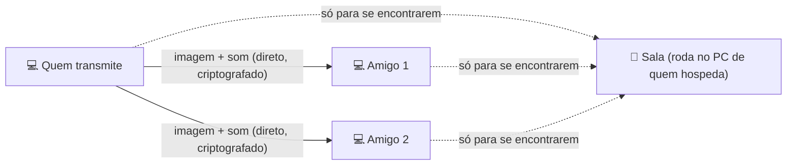
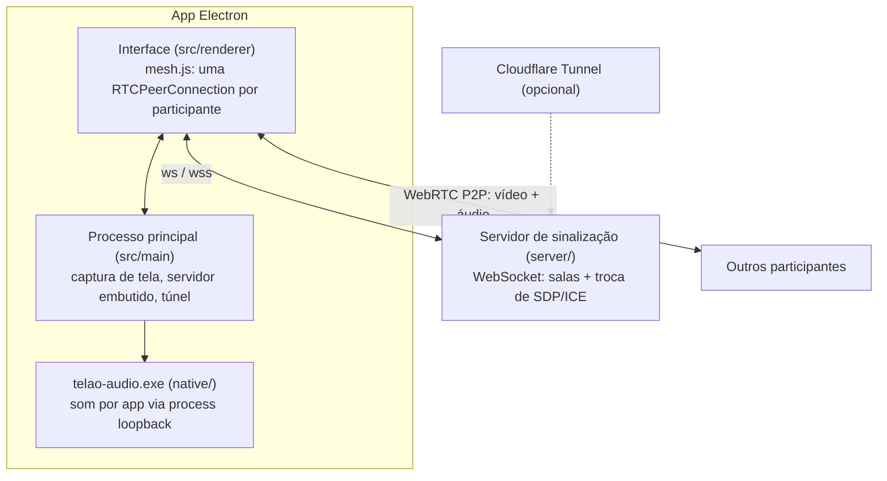

<div align="center">


# Telão

**Compartilhe a tela com seus amigos, com som, direto de PC para PC.**

Escolha a tela ou a janela, a resolução, o FPS e a qualidade.
O som do **Discord não vai junto**, então ninguém ouve a própria voz de volta.

[**⬇️ Baixar para Windows**](https://github.com/MuriloGarmatter/ScreenSharing/releases) ·
[Início rápido](#-início-rápido) ·
[Passo a passo](#-passo-a-passo) ·
[Problemas comuns](#-problemas-comuns)

</div>

---

## Índice

- [O que o Telão faz](#-o-que-o-telão-faz)
- [O que você precisa](#-o-que-você-precisa)
- [Baixar e abrir](#-baixar-e-abrir)
- [Início rápido](#-início-rápido)
- [Passo a passo](#-passo-a-passo)
  - [1. Criar uma sala (quem hospeda)](#1-criar-uma-sala-quem-hospeda)
  - [2. Entrar numa sala (os amigos)](#2-entrar-numa-sala-os-amigos)
  - [3. Transmitir a sua tela](#3-transmitir-a-sua-tela)
  - [4. Assistir a tela dos outros](#4-assistir-a-tela-dos-outros)
- [Som: como o Discord fica de fora](#-som-como-o-discord-fica-de-fora)
- [Qualidade, FPS e internet](#-qualidade-fps-e-internet)
- [Conectando pela internet](#-conectando-pela-internet)
- [Problemas comuns](#-problemas-comuns)
- [Perguntas frequentes](#-perguntas-frequentes)
- [Privacidade e segurança](#-privacidade-e-segurança)
- [Para desenvolvedores](#-para-desenvolvedores)

---

## ✨ O que o Telão faz

- **Transmite sua tela inteira ou só uma janela** (um jogo, o navegador, um filme…).
- **Com som do computador**, mas **sem o som do Discord** e de outros apps de voz (TeamSpeak, Teams, Zoom, Skype, WhatsApp…).
- **Você escolhe a qualidade:** resolução de 480p a nativa, de 5 a 60 FPS, bitrate e codec. Dá para mudar tudo **durante** a transmissão.
- **Várias pessoas podem transmitir ao mesmo tempo**, e todo mundo vê todas as telas.
- **Direto de PC para PC (P2P):** a imagem e o som não passam por nenhum servidor de terceiros.
- **Sem cadastro e sem mensalidade.** Um amigo cria a sala, manda um link e pronto.

### Como funciona, em uma imagem



A "sala" só serve para os computadores se encontrarem. Depois disso, a imagem e o som vão
**direto** de um PC para o outro.

---

## 💻 O que você precisa

| | |
|---|---|
| **Sistema** | Windows 10 ou Windows 11, 64 bits. Para o filtro que tira o som do Discord: Windows 10 versão 2004 (2020) ou mais nova |
| **Internet** | Qualquer uma para assistir. Para **transmitir**, quanto mais **upload**, melhor (veja [a tabela](#quanto-de-internet-a-transmissão-usa)) |
| **Conta** | Nenhuma. Não precisa se cadastrar em nada |

> No Windows 10 mais antigo que a versão 2004 (de 2020), o app funciona, mas o filtro que
> tira o som do Discord não fica disponível. Para ver sua versão, aperte `Win + R`, digite
> `winver` e dê Enter.

---

## 📥 Baixar e abrir

1. Entre na página de **[Releases](https://github.com/MuriloGarmatter/ScreenSharing/releases)**.
2. Na versão mais recente, em **Assets**, baixe **um** destes arquivos (~110 MB):

| Arquivo | Quando usar |
|---|---|
| `Telao-1.0.0-portable.exe` | **Mais fácil.** Não instala nada: é só abrir. Ideal para quem só vai assistir ou transmitir de vez em quando. Demora alguns segundos para abrir. |
| `Telao-Setup-1.0.0.exe` | **Instalador.** Cria atalho no menu Iniciar e abre mais rápido. Recomendado para **quem vai hospedar a sala** com frequência. |

3. Abra o arquivo baixado.
   - No instalador, quando ele perguntar **para quem instalar**, escolha **só para você** (o usuário
     atual). Assim não precisa de senha de administrador.

### "O Windows protegeu o computador" (tela azul do SmartScreen)

Isso aparece porque o app é novo e não tem uma assinatura digital paga (que custa caro).
Não é vírus. Para abrir:

1. Clique em **Mais informações**.
2. Clique em **Executar assim mesmo**.

### Aviso do Firewall do Windows

Na primeira vez que você **hospedar uma sala**, o Windows pode perguntar se o Telão pode usar a rede.
Clique em **Permitir**. Sem isso, os amigos da mesma rede não conseguem entrar na sua sala.

### O antivírus reclamou

Alguns antivírus desconfiam de qualquer programa novo sem assinatura (o chamado "falso positivo").
Se o antivírus bloquear, restaure o arquivo e marque como confiável, ou use a versão **instalador**.

---

## 🚀 Início rápido

**Quem cria a sala (só uma pessoa):**

1. Abra o Telão, digite seu nome e escolha **Hospedar neste PC**.
2. Clique em **Criar sala e entrar**.
3. No painel **Convidar amigos**, copie o link **Pela internet** (começa com `wss://`) e mande
   para os amigos junto com o **nome da sala**.

**Os amigos:**

1. Abram o Telão, digitem o nome e escolham **Entrar em um servidor**.
2. Colem o link em **Endereço do servidor** e digitem **o mesmo nome de sala**.
3. Cliquem em **Entrar na sala**.

**Para transmitir:** clique em **Compartilhar tela**, escolha a tela ou a janela e clique em **Transmitir**. 🎉

---

## 📖 Passo a passo

### 1. Criar uma sala (quem hospeda)

Uma pessoa do grupo "hospeda" a sala. O computador dela vira o ponto de encontro, e ela precisa
**ficar com o Telão aberto** enquanto todos estiverem usando.

Na tela inicial:

| Campo | O que colocar |
|---|---|
| **Seu nome** | Como os outros vão te ver (até 32 letras). |
| **Sala** | O nome da sala (até 64 letras). O botão 🔀 ao lado gera um nome difícil de adivinhar, como `sala-k3x9q2a`, o que é bom para ninguém de fora entrar por acaso. |
| **Hospedar neste PC** | Selecione esta opção. |
| **Porta** | Deixe `47800`. Só mude se o app avisar que a porta já está em uso. |
| **Senha** *(opcional)* | Se colocar, os amigos vão precisar dela para entrar. |
| **Criar link público pela internet** | Deixe **marcado** se algum amigo estiver em outra casa. |

Clique em **Criar sala e entrar**.

Na direita aparece o painel **Convidar amigos** com dois endereços. Cada um tem um botão de copiar:

- **Na mesma rede (Wi-Fi ou cabo):** algo como `192.168.0.10:47800`. Serve para quem está na
  **mesma casa/rede** que você.
- **Pela internet:** um link como `wss://palavras-aleatorias.trycloudflare.com`. Serve para
  **qualquer pessoa, de qualquer lugar**.

Mande para os amigos:
1. o endereço,
2. o **nome da sala** (aparece no topo da tela, ao lado de "Telão /"),
3. a **senha**, se você colocou uma.

> **Na primeira vez**, o link pela internet precisa de um programa gratuito da Cloudflare
> chamado `cloudflared` (~60 MB). O Telão mostra o botão **Baixar e criar link**. Clique nele uma
> vez e pronto: o download vem do GitHub oficial da Cloudflare e fica guardado para as próximas vezes.

> **O link pela internet muda toda vez** que você cria a sala. Mande o novo link a cada vez.
> Ele pode levar alguns segundos para começar a funcionar depois de aparecer.

> **Se você sair da sala ou fechar o Telão, a sala acaba** para todo mundo. Ao clicar em **Sair**
> com gente na sala, o app pede confirmação; fechar a janela encerra direto.

### 2. Entrar numa sala (os amigos)

Na tela inicial:

| Campo | O que colocar |
|---|---|
| **Seu nome** | Como os outros vão te ver. |
| **Sala** | **Exatamente o mesmo nome** que quem hospeda passou. |
| **Entrar em um servidor** | Selecione esta opção. |
| **Endereço do servidor** | Cole o endereço que recebeu. Pode ser o link `wss://…`, um `https://…` ou um `192.168.0.10:47800`. O app entende os três. |
| **Senha do servidor** | Só se quem hospeda tiver colocado uma. |

Clique em **Entrar na sala**.

Dentro da sala, a lista **Participantes** mostra quem está lá e como está a conexão com cada um:

| Etiqueta | Significado |
|---|---|
| `conectando…` | Os dois computadores ainda estão se encontrando (normalmente leva 1 a 3 segundos). |
| `conectado` | Conectou; em seguida a etiqueta mostra o tipo de conexão. |
| `rede local` | Conexão direta pela mesma rede. A melhor possível. |
| `P2P direto` | Conexão direta pela internet. Ótima. |
| `via TURN` | A conexão passa por um servidor intermediário (só se configurado). Funciona, mas com um pouco mais de atraso. |
| `falhou` | Não deu para conectar com essa pessoa. Veja [Problemas comuns](#participante-fica-em-conectando-ou-falhou). |
| `AO VIVO` | É você, transmitindo. |

O app lembra seu nome, a sala e o endereço para a próxima vez.

### 3. Transmitir a sua tela

1. Clique em **Compartilhar tela** (botão azul no alto).
2. Escolha o que transmitir:
   - **Telas inteiras:** tudo o que aparece no monitor. Se você tem dois monitores, aparecem os dois;
     o principal está marcado como "principal".
   - **Janelas:** só uma janela, como o jogo, o navegador ou o player de vídeo. O resto da sua tela
     fica escondido.
   - Clique em **Atualizar** se a janela que você quer não aparecer.
3. Escolha o **som** (veja [a seção de som](#-som-como-o-discord-fica-de-fora)):
   - **Transmitir som** marcado: vai som junto.
   - **Todos os apps, menos os excluídos**: o padrão para tela inteira.
   - **Só o app desta janela**: o padrão para janela.
4. Clique em **Transmitir** (ou dê dois cliques na tela/janela escolhida).

Enquanto você transmite, o painel **Sua transmissão** (à direita) mostra:

- uma **prévia** do que está indo para os outros;
- **quais apps estão no som** e quais ficaram de fora ("Fora da transmissão: Discord");
- um **medidor de som**: a barra verde se mexe quando tem som saindo;
- os **ajustes de qualidade**, que você pode mudar a qualquer momento ([explicação](#-qualidade-fps-e-internet));
- **Enviando para cada pessoa**: a resolução, o FPS e a velocidade reais que cada amigo está recebendo.

Botões:
- **Trocar tela:** muda o que está sendo transmitido, sem parar.
- **Parar** (ou **Parar transmissão**, no alto): encerra a sua transmissão.

> Pode minimizar o Telão enquanto transmite a **tela inteira**. Mas se estiver transmitindo
> **uma janela**, não minimize **essa janela**: o Windows para de desenhar janelas minimizadas,
> e os outros veriam a imagem congelada.

### 4. Assistir a tela dos outros

Quando alguém transmite, a tela da pessoa aparece no meio do Telão. Se várias pessoas transmitirem,
as telas ficam lado a lado.

Passe o mouse sobre a tela de alguém para ver os controles:

| Controle | O que faz |
|---|---|
| 🔊 | Liga/desliga o som dessa pessoa. |
| Barra de volume | Volume só dessa pessoa. |
| ⓘ | Mostra os detalhes: resolução, FPS, velocidade, codec e o tempo de resposta (ms). |
| ⛶ | Tela cheia. **Dois cliques** na imagem também abrem e fecham a tela cheia. `Esc` sai. |

Enquanto você assiste ou transmite, o Telão impede que o monitor apague sozinho.

---

## 🔊 Som: como o Discord fica de fora

O Telão captura o som **app por app**, com a mesma técnica que o OBS usa na captura de áudio por
aplicativo. Por isso dá para escolher quem entra e quem fica de fora.

| Opção | O que vai junto | Padrão para |
|---|---|---|
| **Todos os apps, menos os excluídos** | Tudo o que toca no PC (jogo, música, vídeo…), **menos** os apps da lista de excluídos e o próprio Telão. | Tela inteira |
| **Só o app desta janela** | Só o som do programa daquela janela. | Janela |
| **Tudo, sem filtro (inclui Discord)** | Todo o som do PC, **inclusive** chamadas de voz. Use só se o filtro não estiver funcionando. Nesse modo, o som dos outros participantes fica mudo enquanto você transmite, para não dar eco. | — |

### A lista de excluídos

Clique em **Apps excluídos** na janela de escolha da tela para ver e editar a lista. Por padrão ela já tem:

`Discord.exe` · `DiscordPTB.exe` · `DiscordCanary.exe` · `DiscordDevelopment.exe` ·
`TeamSpeak.exe` · `ts3client_win64.exe` · `ts3client_win32.exe` · `ms-teams.exe` · `Teams.exe` ·
`Zoom.exe` · `Skype.exe` · `WhatsApp.exe` · `Telegram.exe` · `slack.exe` · `mumble.exe` ·
`Guilded.exe` · `Element.exe` · `Signal.exe`

- Coloque **um programa por linha**, com o nome do arquivo `.exe`. Para descobrir o nome de um
  programa, abra o **Gerenciador de Tarefas** (`Ctrl + Shift + Esc`), vá em **Detalhes** e veja a
  coluna "Nome".
- **Restaurar a lista padrão** volta para a lista acima.
- Os processos "filhos" de um app excluído também ficam de fora.

### Como conferir se está funcionando

Durante a transmissão, olhe o painel **Sua transmissão**:

- "**Som dos apps:** Spotify, chrome" mostra os apps cujo som **está indo**.
- "**Fora da transmissão:** Discord" mostra os que **foram barrados**.
- O **medidor verde** mostra o som saindo. Peça para alguém falar no Discord enquanto nada mais
  toca: o medidor deve ficar **parado**.

### Limitações do filtro

- **Discord aberto no navegador** (discord.com no Chrome/Edge/Opera): o som dele é o som do navegador
  e não dá para separar. Use o **aplicativo** do Discord.
- **Transmitindo uma janela de navegador:** vai o som de **todas as abas** daquele navegador.
- Alguns apps da Microsoft Store desenham a janela num processo separado. Se "Só o app desta janela"
  ficar sem som num desses, use **Todos os apps, menos os excluídos**.
- Precisa do **Windows 10 versão 2004** (2020) ou mais novo. Nas versões mais antigas, só a opção
  "Tudo, sem filtro" funciona.

---

## 🎬 Qualidade, FPS e internet

Os ajustes ficam no painel **Sua transmissão**, à direita. Você pode ajustar **antes** de começar
ou **durante** a transmissão, e quem assiste vê a mudança em segundos.

| Ajuste | Opções | Dica |
|---|---|---|
| **Resolução** | 480p · 720p (HD) · 1080p (Full HD) · 1440p (2K) · Nativa (sem reduzir) | 1080p é o melhor equilíbrio. "Nativa" usa a resolução do seu monitor. |
| **Quadros/s (FPS)** | 5 · 10 · 15 · 24 · 30 · 45 · 60 | 60 para jogos. 30 para vídeos. 10–15 para textos e planilhas. |
| **Bitrate máximo** | Automático · 1 a 40 Mb/s | "Automático" calcula pela resolução e FPS. Diminua se a imagem travar. |
| **Otimizar para** | Movimento (jogos, vídeos) · Nitidez (texto, código) | **Movimento** mantém a fluidez e perde nitidez se a internet apertar. **Nitidez** mantém as letras legíveis e perde FPS. |
| **Codec de vídeo** | Automático · H.264 · VP8 · VP9 · AV1 | **H.264** usa a placa de vídeo e alivia o processador, o que é bom para jogos. VP9 e AV1 têm imagem melhor, mas pesam no processador. |

O padrão é **1080p, 30 FPS, bitrate automático, Movimento, codec automático**.

### Sugestões prontas

| Para… | Resolução | FPS | Otimizar para | Codec | Bitrate |
|---|---|---|---|---|---|
| 🎮 Jogos | 1080p | 60 | Movimento | H.264 | Automático |
| 🎬 Filmes, séries, YouTube | 1080p | 30 | Movimento | Automático | Automático |
| 💻 Código, textos, planilhas | Nativa | 15 | Nitidez | Automático | Automático |
| 🐢 Internet fraca | 720p | 30 | Movimento | H.264 | 2 ou 3 Mb/s |

### Quanto de internet a transmissão usa

No P2P, **quem transmite envia uma cópia para cada pessoa assistindo**. Por isso, o que pesa é o
**upload** de quem transmite. Quem só assiste usa pouco.

Valores máximos com bitrate **automático** em "Movimento":

| Qualidade | 1 pessoa assistindo | 2 pessoas | 3 pessoas | 4 pessoas |
|---|---|---|---|---|
| 720p · 30 FPS | 2,8 Mb/s | 5,5 Mb/s | 8,3 Mb/s | 11 Mb/s |
| 1080p · 30 FPS | 6,2 Mb/s | 12 Mb/s | 19 Mb/s | 25 Mb/s |
| 1080p · 60 FPS | 12 Mb/s | 25 Mb/s | 37 Mb/s | 50 Mb/s |
| 1440p · 60 FPS | 22 Mb/s | 44 Mb/s | 66 Mb/s | 89 Mb/s |

- O painel mostra essa conta para a sua sala ("Até X para cada pessoa assistindo: upload total…").
- Telas paradas (texto, área de trabalho) gastam bem menos que o máximo.
- Para saber seu upload, faça um teste em [fast.com](https://fast.com) e abra os detalhes do
  resultado (o upload aparece lá).
- Se o seu upload for menor que o total da tabela, diminua a resolução, o FPS ou o bitrate.
  Senão a imagem trava e fica pixelada para todo mundo.

### Lendo o painel "Enviando para cada pessoa"

Cada amigo tem uma linha, por exemplo `1920×1080 · 30 fps · 5,8 Mb/s · H264 (GPU)`. Se aparecer:

- **Limitado pela internet (banda):** sua internet (ou a do amigo) não está dando conta. Diminua o
  bitrate, a resolução ou o FPS.
- **Limitado pelo processador (CPU):** seu PC não está dando conta de comprimir o vídeo. Troque o
  codec para **H.264** ou diminua a resolução/FPS.

O som vai em estéreo com qualidade de música, independentemente desses ajustes.

---

## 🌐 Conectando pela internet

| Jeito | Quando usar | Como |
|---|---|---|
| **Link público (Cloudflare)** | O normal: amigos em outras casas. | Já vem marcado em "Hospedar neste PC". Grátis e sem configurar o roteador. |
| **Mesma rede** | Todos na mesma casa/Wi-Fi. | Use o endereço "Na mesma rede" (`192.168.x.x:47800`). |
| **VPN de jogos** (Radmin VPN, ZeroTier, Tailscale…) | Se o link da Cloudflare não funcionar na rede de alguém. | Todos entram na mesma rede virtual e usam o IP da VPN de quem hospeda, por exemplo `26.x.x.x:47800`. |
| **Servidor fixo** | Para ter sempre o mesmo endereço, sem depender de alguém hospedar. | Veja "Servidor sempre ligado" em [Para desenvolvedores](#-para-desenvolvedores). |

Lembre: o link e o servidor só servem para os PCs **se encontrarem**. Depois disso, a imagem e o
som vão **direto** entre os computadores. Por isso, numa rede muito restrita (algumas redes de
empresa, faculdade ou 4G), a conexão direta pode falhar. Veja
[Participante fica em "conectando…" ou "falhou"](#participante-fica-em-conectando-ou-falhou).

---

## 🧰 Problemas comuns

### "Não foi possível conectar ao servidor"

- Confira se o endereço foi colado **inteiro** (copie de novo com o botão de copiar).
- Quem hospeda está com o Telão aberto e **dentro da sala**?
- O link pela internet **muda toda vez** que a sala é criada. Peça o link novo.
- Um link que acabou de ser criado pode levar **alguns segundos** para funcionar. Tente de novo em 10–30 segundos.
- Endereço da **mesma rede** (`192.168.…`): só funciona se vocês estiverem na mesma rede, e quem
  hospeda precisa ter clicado em **Permitir** no aviso do Firewall do Windows.

### "Senha do servidor incorreta" / "A sala está cheia"

- A senha diferencia maiúsculas de minúsculas. Peça de novo para quem hospeda.
- Cada sala aceita até **10 pessoas**.

### Participante fica em "conectando…" ou "falhou"

Vocês entraram na sala, mas o P2P entre os dois PCs não fechou. Isso acontece em algumas redes
mais fechadas.

1. Espere uns segundos: o app tenta de novo sozinho.
2. Tente outra rede (por exemplo, o Wi-Fi de casa em vez do 4G).
3. Usem uma **VPN de jogos** (Radmin VPN, ZeroTier, Tailscale) e entrem pelo IP da VPN.
4. Quem entende um pouco mais pode configurar um **servidor TURN** em "Avançado: servidor TURN",
   ao criar a sala. Ele retransmite a conexão quando a direta não é possível.

### A tela aparece preta

- **Netflix, Prime Video, Disney+ e outros no navegador** bloqueiam captura de tela (proteção
  contra cópia). A imagem fica preta e não há como contornar no Telão.
- **Jogo em tela cheia exclusiva:** coloque o jogo em **Janela sem bordas** (Borderless) ou
  **Janela** nas configurações de vídeo do jogo, ou transmita a tela inteira.
- **Transmitindo uma janela minimizada:** restaure a janela.
- Clique em **Trocar tela** e escolha de novo.

### Não está indo som

- **Transmitir som** estava marcado na hora de escolher a tela? Se não estava, clique em **Trocar tela** e marque.
- Olhe o painel **Sua transmissão**. Se diz "nenhum tocando agora", o Telão não está vendo nenhum app tocando:
  - o app está tocando mesmo? (aumente o volume dele);
  - o app está na **lista de excluídos**?
- Em **Só o app desta janela**, só vai o som **daquele** programa. Se a música toca em outro programa, use
  **Todos os apps, menos os excluídos**.
- Quem assiste: confira se o 🔊 da sua tela não está desligado e se a barra de volume não está zerada.

### O som do Discord está indo junto

- Confira se a opção de som **não** é "Tudo, sem filtro".
- O Discord está aberto **no navegador**? Aí não dá para separar. Use o aplicativo do Discord.
- Confira se `Discord.exe` está na lista de **Apps excluídos** (o botão **Restaurar a lista padrão** coloca de volta).
- O painel **Sua transmissão** deve mostrar "Fora da transmissão: Discord" quando o Discord estiver tocando algo.

### Eco ou som repetido

- Em "Todos os apps, menos os excluídos" e "Só o app desta janela" o próprio Telão fica de fora,
  então não há eco.
- Em "Tudo, sem filtro", deixe marcada a opção **Silenciar o som dos outros enquanto eu transmito com som**.
- **Testando com dois Telões no mesmo PC:** você vai ouvir o som duas vezes (o original e o que
  chegou pela transmissão). Silencie o 🔊 na tela recebida. Entre PCs diferentes isso não acontece.

### A imagem trava, fica pixelada ou atrasada

1. Abra o ⓘ na tela de quem transmite (ou veja "Enviando para cada pessoa", se for você transmitindo).
2. Se aparecer **Limitado pela internet**: diminua o **bitrate**, a **resolução** ou o **FPS**.
   Confira [a tabela de upload](#quanto-de-internet-a-transmissão-usa).
3. Se aparecer **Limitado pelo processador**: troque o codec para **H.264**.
4. Prefira **cabo** a Wi-Fi para quem transmite.
5. Com muita gente assistindo, o upload de quem transmite multiplica. Diminua a qualidade.

### "Reconectando…" no alto da tela

O Telão perdeu contato com a sala: quem hospeda caiu, fechou o app ou a internet oscilou.
As transmissões que já estavam rolando **continuam**, e o app tenta reconectar sozinho.

### O link pela internet não aparece

- Clique em **Criar link público** de novo.
- Se o download do `cloudflared` falhar, pode ser o antivírus ou um bloqueio de rede. Tente de novo
  ou use uma [VPN de jogos](#-conectando-pela-internet).

---

## ❓ Perguntas frequentes

**Funciona no Mac, no Linux ou no celular?**
Esta versão é só para **Windows** (10 e 11, 64 bits).

**Quantas pessoas cabem numa sala?**
Até **10**. Na prática, quem transmite em 1080p costuma dar conta de **3 a 5 pessoas assistindo**,
dependendo do upload ([veja a tabela](#quanto-de-internet-a-transmissão-usa)).

**Mais de uma pessoa pode transmitir ao mesmo tempo?**
Pode. As telas aparecem lado a lado para todo mundo.

**Custa alguma coisa?**
Não. O link da Cloudflare é gratuito, e a imagem vai direto entre os computadores.

**Precisa de conta ou cadastro?**
Não.

**O Telão grava alguma coisa?**
Não. Nada é gravado nem guardado. O app só lembra suas configurações (nome, sala, qualidade) neste computador.

**Posso usar o Telão e o Discord ao mesmo tempo?**
Pode, é a ideia. Fale pelo Discord e transmita pelo Telão: o som do Discord não entra na transmissão.

**Dá para abrir dois Telões no mesmo PC para testar?**
Dá, com a versão **instalada** ("só para você"). Abra o primeiro normalmente. Para o segundo, aperte
`Win + R` e rode, com um perfil separado:
`"%LOCALAPPDATA%\Programs\Telao\Telao.exe" --profile=teste`
Num deles, hospede. No outro, entre com o endereço `127.0.0.1:47800`.

---

## 🔒 Privacidade e segurança

- **A imagem e o som vão direto entre os computadores, criptografados** (o padrão WebRTC, DTLS-SRTP,
  o mesmo do Google Meet). Se um servidor TURN for usado, ele só repassa os dados criptografados.
- **A sala** (no PC de quem hospeda) só vê os nomes, o nome da sala e os dados técnicos para os
  PCs se conectarem. Ela não recebe imagem nem som.
- **O link da Cloudflare** só repassa essa conversa de "apresentação". A imagem e o som não passam por ele.
- **Como em todo P2P, os participantes conseguem ver o endereço IP uns dos outros.** Use salas só com
  pessoas de confiança.
- Quem tiver o endereço **e** o nome da sala consegue entrar. Para evitar estranhos, use o botão 🔀
  para gerar um nome de sala difícil de adivinhar e/ou coloque uma **senha**.
- **Nada é gravado.** As configurações ficam só no seu PC, em `%APPDATA%\Telao`.

---

## 🔧 Para desenvolvedores

<details>
<summary><b>Rodar a partir do código, gerar o executável, hospedar o servidor</b></summary>

### Requisitos

- Windows 10/11 64 bits
- [Node.js](https://nodejs.org) 18 ou mais novo (testado com o 22)
- Git

Não precisa instalar Visual Studio nem .NET: o auxiliar de som é compilado com o compilador C# que já
vem no Windows (.NET Framework 4).

### Rodar

```bash
git clone https://github.com/MuriloGarmatter/ScreenSharing.git
cd ScreenSharing
npm install
npm start
```

Para abrir uma segunda instância no mesmo PC: `npm start -- --profile=b`.

### Comandos

| Comando | O que faz |
|---|---|
| `npm start` | Compila o auxiliar de som e abre o app em modo de desenvolvimento. |
| `npm test` | Testes de lógica: servidor de sinalização, ajustes de SDP, bitrate, buffer de áudio. Não abre nada. |
| `npm run test:audio` | Testa a captura de som por app de verdade. **Toca dois tons baixinhos** por ~15 s. |
| `npm run test:e2e` | **Abre duas janelas do app** e testa tudo de ponta a ponta (~1 min, com tons). |
| `npm run dist` | Gera `dist/Telao-1.0.0-portable.exe` e `dist/Telao-Setup-1.0.0.exe`. |
| `npm run server` | Roda só o servidor de sinalização (porta 47800). |

`Ctrl + Shift + I` abre as ferramentas de desenvolvedor dentro do app.

### Como funciona



- **Tela:** `desktopCapturer` + `setDisplayMediaRequestHandler` do Electron. A qualidade é ajustada
  com `applyConstraints` (resolução/FPS de captura) e `RTCRtpSender.setParameters`
  (bitrate, FPS e codec por envio).
- **P2P:** malha (mesh) com uma conexão por par de participantes, no padrão
  ["perfect negotiation"](https://developer.mozilla.org/docs/Web/API/WebRTC_API/Perfect_negotiation).
  Uma conexão por pessoa significa que cada uma recebe a qualidade que a internet dela aguenta.
- **Som por aplicativo:** `native/TelaoAudio.cs` usa a API de *process loopback* do WASAPI
  (Windows 10 2004+). Ele lista os apps com sessão de áudio, descarta os excluídos (e os filhos
  deles), captura cada app separadamente e manda o PCM pelo stdout. A interface mistura tudo com
  um `AudioWorklet` e envia como faixa WebRTC (Opus estéreo, 160 kb/s).
- **Link público:** `cloudflared tunnel --url` (Quick Tunnel), iniciado pelo app.

### Estrutura

```
src/main/          processo principal (janela, captura, servidor embutido, túnel, som por app)
src/renderer/      interface e WebRTC (app.js, mesh.js, media.js, app-audio.js, pcm-worklet.js)
server/            servidor de sinalização (embutido no app ou sozinho)
native/            código do telao-audio.exe
scripts/           ícone, compilação do auxiliar, inicialização
test/              testes (unitários, áudio, ponta a ponta)
```

### Servidor sempre ligado (opcional)

O servidor de sinalização é leve e pode rodar sozinho num PC sempre ligado ou numa hospedagem.
Assim o endereço nunca muda e ninguém precisa "hospedar".

```bash
cd server
npm install
npm start
```

| Variável de ambiente | Para quê |
|---|---|
| `PORT` | Porta (padrão `47800`). |
| `SERVER_PASSWORD` | Exige senha para entrar em qualquer sala. |
| `TURN_URLS`, `TURN_USERNAME`, `TURN_CREDENTIAL` | Servidor TURN próprio (ex.: coturn), repassado aos participantes. |
| `CLOUDFLARE_TURN_KEY_ID`, `CLOUDFLARE_TURN_API_TOKEN` | Gera credenciais do TURN da Cloudflare (1.000 GB/mês grátis). |

**No Render (grátis):** crie um *Web Service* a partir deste repositório com
*Root Directory* `server`, *Build Command* `npm install` e *Start Command* `npm start`.
Os amigos entram com `wss://SEU-SERVICO.onrender.com`. No plano grátis, o serviço "dorme" depois
de um tempo sem uso, e a primeira conexão pode levar cerca de um minuto para acordá-lo.

### Publicar uma nova versão

1. Aumente a `version` no `package.json`.
2. Rode `npm run dist`.
3. Crie a release com os dois `.exe`:
   `gh release create vX.Y.Z dist/Telao-X.Y.Z-portable.exe dist/Telao-Setup-X.Y.Z.exe`

</details>
