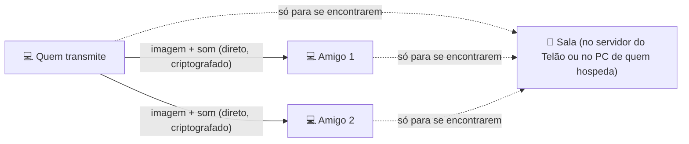
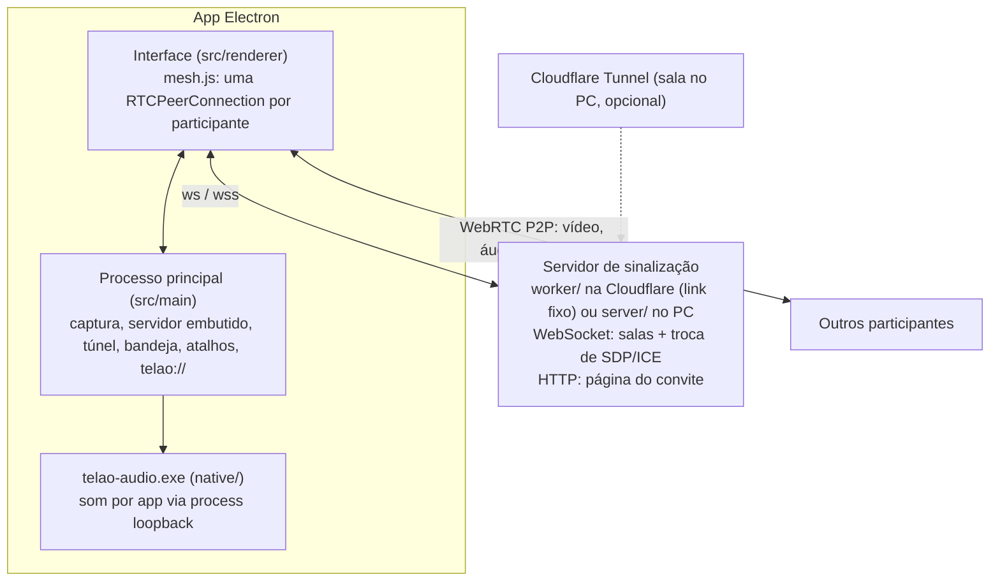

<div align="center">


# Telão

**Compartilhe a tela com seus amigos, com som, direto de PC para PC.**

Escolha a tela ou a janela, a resolução, o FPS e a qualidade.
O som do **Discord não vai junto**, então ninguém ouve a própria voz de volta.

[Como conseguir o Telão](#-como-conseguir-e-abrir-o-telão) ·
[Início rápido](#-início-rápido) ·
[Passo a passo](#-passo-a-passo) ·
[Problemas comuns](#-problemas-comuns)

</div>

> [!IMPORTANT]
> - **Dá para conversar pelo próprio Telão** (a partir da 1.5): ligue o microfone no painel **Voz**.
>   Quem preferir pode continuar numa chamada do Discord ao mesmo tempo: o som dessa chamada não
>   entra na transmissão.
> - **Netflix, Prime Video, Disney+ e outros streamings pagos aparecem PRETOS** para quem assiste,
>   por proteção contra cópia. YouTube, vídeos baixados e jogos funcionam.

---

## Índice

- [O que o Telão faz](#-o-que-o-telão-faz)
- [O que você precisa](#-o-que-você-precisa)
- [Como conseguir e abrir o Telão](#-como-conseguir-e-abrir-o-telão)
- [Início rápido](#-início-rápido)
- [Passo a passo](#-passo-a-passo)
  - [1. Criar uma sala](#1-criar-uma-sala)
  - [2. Entrar numa sala (os amigos)](#2-entrar-numa-sala-os-amigos)
  - [3. Transmitir a sua tela](#3-transmitir-a-sua-tela)
  - [4. Assistir a tela dos outros](#4-assistir-a-tela-dos-outros)
  - [5. Ligar a câmera](#5-ligar-a-câmera)
  - [6. Conversar por voz](#6-conversar-por-voz)
  - [7. Avisos, bandeja e cores](#7-avisos-bandeja-e-cores)
- [Atalhos de teclado](#-atalhos-de-teclado)
- [Som: como o Discord fica de fora](#-som-como-o-discord-fica-de-fora)
- [Qualidade, FPS e internet](#-qualidade-fps-e-internet)
- [Conectando pela internet](#-conectando-pela-internet)
- [Problemas comuns](#-problemas-comuns)
- [Perguntas frequentes](#-perguntas-frequentes)
- [Privacidade e segurança](#-privacidade-e-segurança)
- [Para desenvolvedores](#-para-desenvolvedores)

---

## ✨ O que o Telão faz

- **Transmite a tela inteira ou só uma janela** (um jogo, o navegador, um vídeo…).
- **Vai com o som do computador, mas sem o som do Discord** e de outros apps de voz (TeamSpeak, Teams,
  Zoom, Skype, WhatsApp…). Ou só o som dos apps que você escolher.
- **Convite com um clique:** quem cria a sala manda um link, e quem clica abre o Telão já na sala.
  O link é **fixo**: a sala fica num servidor do Telão sempre ligado, então ninguém precisa hospedar.
- **Qualidade em um clique:** Jogo · Filme · Texto · Internet fraca. Os ajustes finos
  (resolução, FPS, bitrate, codec) continuam lá e mudam **durante** a transmissão.
- **Pesa pouco no jogo:** quando a placa de vídeo comprime o vídeo (H.264), o app usa ela sozinho.
- **Várias pessoas podem transmitir ao mesmo tempo.** Dá para **destacar** uma tela, assistir numa
  **janelinha flutuante** por cima do jogo, mandar **reações** (😂🔥👏) e **parar de assistir** quem
  você não quer ver: a tela dessa pessoa sai do caminho.
- **Câmera:** cada um pode ligar a webcam (sem som), junto com a tela ou sozinha.
- **Voz:** conversem pelo próprio Telão, com cancelamento de eco e redução de ruído. Dá para
  ligar e desligar o microfone com `Ctrl+Alt+M`, até com o jogo aberto.
- **Pausa com uma tecla** (`Ctrl+Alt+P`) para quando aparecer algo que você não quer mostrar.
- **Avisa quando alguém começa a transmitir**, com som, notificação e a barra de tarefas piscando.
- **Vai direto de PC para PC:** a imagem e o som não passam por nenhum servidor de terceiros.
- **Dá para escolher as cores do app:** tema escuro, claro ou igual ao do Windows, e a cor de destaque.
- **Sem cadastro e sem mensalidade.**

### Como funciona, em uma imagem



A "sala" só serve para os computadores se encontrarem. Depois disso, a imagem e o som vão
**direto** de um PC para o outro. Isso é o que se chama de conexão P2P.

---

## 💻 O que você precisa

- **Windows 10 ou Windows 11, 64 bits.** O filtro que tira o som do Discord precisa do Windows 10
  versão 2004 (de 2020) ou mais nova. Para ver sua versão, aperte `Win + R`, digite `winver` e dê Enter.
- **Internet.** Para assistir, qualquer uma serve. Para **transmitir**, o que importa é o **upload**,
  a velocidade de **envio** da sua internet, que costuma ser bem menor que a de download
  ([veja a tabela](#quanto-de-internet-a-transmissão-usa)).
- **Nenhuma conta.** Não precisa se cadastrar em nada.

---

## 📥 Como conseguir e abrir o Telão

### 1. Pegue o arquivo

O Telão vem em dois sabores (~110 MB cada). Use **um** deles:

| Arquivo | Quando usar |
|---|---|
| `Telao-Setup-<versão>.exe` | **Instalador (recomendado).** Cria atalho no menu Iniciar, abre mais rápido e faz o **convite clicável** funcionar sempre. |
| `Telao-<versão>-portable.exe` | Não instala nada: é só abrir. O convite clicável funciona depois de abrir o portátil uma vez. Demora uns segundos para abrir. |

Baixe na página de **Releases** deste repositório, na parte **Assets** da versão mais recente (ou peça
o arquivo a quem te convidou). Ali, não baixe o "Source code": ele é o código, não o programa.

**Atualizações:** a partir da 1.3, o Telão **instalado** se atualiza sozinho. Ele baixa a versão nova
em segundo plano e mostra um aviso: clique em **Reiniciar e atualizar** (no aviso, no botão do alto ou
no ícone da bandeja) ou só feche o Telão, que ela é instalada ao sair. O **portátil** não consegue se
atualizar: ele só avisa que há versão nova e abre a página para baixar. Por isso, prefira o instalador.

### 2. Se o navegador avisar ao baixar

Programas novos e sem assinatura digital paga costumam gerar avisos. **Só siga os passos abaixo com o
arquivo que veio de alguém que você conhece.** Nunca faça isso com um `.exe` recebido de estranhos.

- **Edge:** aparece "*… não é baixado com frequência*". Clique nos **três pontinhos (…)** → **Manter**
  → **Mostrar mais** → **Manter mesmo assim**.
- **Chrome:** abra os downloads e escolha **Manter** (ou **Baixar arquivo suspeito**).

### 3. Abra o arquivo

Na primeira vez, o Windows mostra a tela azul "**O Windows protegeu o computador**" (SmartScreen).
Ela deve mostrar **Editor desconhecido** e o nome do arquivo do Telão. Para abrir:

1. Clique em **Mais informações**.
2. Clique em **Executar assim mesmo**.

No **instalador**:

- Em "**Para quem esta aplicação deve ser instalada?**", deixe **Apenas para mim** (já vem marcado).
  Assim não precisa de senha de administrador.
- Na tela da pasta, não mude nada e clique em **Instalar**.

> [!NOTE]
> Se aparecer "**O Controle Inteligente de Aplicativos bloqueou…**" (Windows 11), o Windows está
> barrando todo app sem assinatura digital, e não dá para liberar só o Telão. Desligar esse controle
> é uma decisão sua: fica em **Segurança do Windows → Controle de aplicativos e do navegador**. Leia o
> aviso do Windows antes.

### Se o antivírus barrar

O sintoma costuma ser o arquivo **sumir** da pasta Downloads, ou aparecer um aviso da Segurança do
Windows. Alguns antivírus desconfiam de qualquer programa novo sem assinatura (o chamado "falso
positivo").

- **Nunca desative o antivírus.** Libere **só este arquivo**, e só se ele veio de quem você confia.
- **Microsoft Defender (o padrão do Windows):** Iniciar → **Segurança do Windows** → **Proteção contra
  vírus e ameaças** → **Histórico de proteção** → clique no item do Telão → **Ações** → **Restaurar**
  (ou **Permitir no dispositivo**).
- **Outros antivírus:** procure por "Quarentena" e "Exceções".
- Se o antivírus apontar um vírus **com nome específico**, não libere e avise quem te mandou.

**Para conferir se o arquivo é o original**, compare a impressão digital (SHA-256) com a que está nas
notas da versão (ou peça a quem te mandou). No Prompt de Comando:

```
certutil -hashfile "%USERPROFILE%\Downloads\Telao-Setup-1.2.0.exe" SHA256
```

Troque o nome pelo arquivo que você baixou. Se o código for diferente, não abra.

---

## 🚀 Início rápido

**Quem cria a sala (só uma pessoa):**

1. Abra o Telão, escolha **Criar sala** e digite seu nome. Dê um nome para a sala, como
   `filme-sexta`, ou use o que o app sorteia.
2. Deixe **Servidor do Telão** escolhido e clique em **Criar sala e entrar**.
3. No painel **Convidar amigos**, copie o **Link fixo** (algo como
   `https://telao.xmbc.workers.dev/filme-sexta`) e mande para os amigos no Discord ou no WhatsApp.

O link **não muda**: da próxima vez, entre de novo na mesma sala e o mesmo link funciona. Dá para
deixar ele fixado no canal do Discord. Ninguém precisa ficar hospedando: quem criou a sala pode sair e
voltar à vontade.

**Os amigos:**

1. **Cliquem no link.** Abre uma página "Convite para o Telão": cliquem em **Abrir no Telão** e
   permitam se o navegador perguntar. O Telão abre já entrando na sala.
2. Na primeira vez, o Telão pede o nome. Digitem e cliquem em **Entrar na sala**.

Não abriu? Copiem o link e abram o Telão: aparece "**Você copiou um convite**". Cliquem em **Entrar**.

**Para transmitir:** clique em **Compartilhar tela**, escolha a tela ou a janela e clique em
**Transmitir** (ou aperte `Ctrl+Alt+T`). 🎉

---

## 📖 Passo a passo

### 1. Criar uma sala

Na tela inicial, escolha **Criar sala** e preencha:

| Campo | O que colocar |
|---|---|
| **Seu nome** | Como os outros vão te ver (até 32 letras). |
| **Nome da sala** | O app já sorteia um difícil de adivinhar (como `sala-k3x9q2a`), mas você pode escrever outro, como `filme-sexta`. O botão 🔀 sorteia outro. Maiúsculas e minúsculas não importam. **Quem souber o nome entra**, então evite nomes óbvios como `teste`. |
| **Onde fica a sala** | **Servidor do Telão** (recomendado) ou **Este computador**. Veja abaixo. |

Clique em **Criar sala e entrar**.

#### Servidor do Telão (recomendado)

A sala fica num servidor do Telão na Cloudflare, sempre ligado. O convite é um **link fixo**, como
`https://telao.xmbc.workers.dev/filme-sexta`:

- O link **não muda**. Mande uma vez (ou fixe no canal do Discord) e use sempre.
- **Ninguém precisa hospedar.** Qualquer pessoa pode sair e voltar, inclusive quem criou a sala, e a
  sala continua para quem ficou.
- Não baixa nada, não pede o Firewall e funciona de qualquer lugar.
- **Qualquer pessoa na sala** pode copiar o link no painel **Convidar amigos**.
- O servidor só apresenta as pessoas da sala umas às outras. A imagem e o som continuam indo **direto
  entre os PCs**.

#### Este computador

O seu PC vira o ponto de encontro da sala, e você precisa **ficar com o Telão aberto** enquanto todos
estiverem usando. Serve para jogar na mesma rede sem internet, ou se o servidor do Telão estiver fora
do ar. Escolhendo esta opção, aparecem mais campos:

| Campo | O que colocar |
|---|---|
| **Porta** | Deixe `47800`. Só mude se o app avisar que a porta já está em uso. |
| **Senha** *(opcional)* | Se colocar, os amigos vão precisar dela. O app não guarda senhas: digite de novo a cada vez. |
| **Criar link público pela internet** | Deixe **marcado** se algum amigo estiver em outra casa. |

**Aviso do Firewall do Windows:** na primeira vez, o Windows pode perguntar se o Telão pode usar a
rede. Clique em **Permitir acesso**. Sem isso, quem entra pela mesma rede (ou por VPN de jogos) não
consegue chegar até você. Quem entra pelo link da internet não depende disso. Se você clicou em
**Cancelar**, veja [Cliquei em Cancelar no aviso do Firewall](#cliquei-em-cancelar-no-aviso-do-firewall).

Na direita aparece o painel **Convidar amigos**. Cada endereço é um **convite**: um link comum, que já
leva o nome da sala, com um botão de copiar ao lado.

- **Pela internet:** um link como `https://palavras-aleatorias.trycloudflare.com/sala-k3x9q2a`.
  Serve para **qualquer pessoa, de qualquer lugar**.
  - **Na primeira vez**, aparece o botão **Baixar e criar link**. O link usa um programa gratuito da
    Cloudflare chamado `cloudflared` (~60 MB), que o Telão baixa do GitHub oficial da Cloudflare e
    guarda para as próximas vezes.
  - O link **muda toda vez** que você cria a sala. Mande o novo a cada vez.
  - Ele pode levar **alguns segundos** para começar a funcionar depois de aparecer.
- **Na mesma rede (Wi-Fi ou cabo):** algo como `http://192.168.0.10:47800/sala-k3x9q2a`. Serve para
  quem está na **mesma casa/rede** que você.
  - Aparece um endereço para cada placa de rede do PC, com o nome da placa em cima. Mande o da placa
    **Wi-Fi** ou **Ethernet** (normalmente começa com `192.168.` ou `10.`).
  - Placas de VPN aparecem no fim da lista: no Radmin VPN o endereço começa com `26.`, no Tailscale
    com `100.`. Elas só servem para quem está na mesma VPN.
  - Placas de máquinas virtuais (VirtualBox, VMware, WSL, "vEthernet") não servem.

> **Se você sair da sala ou fechar o Telão, a sala acaba** para todo mundo. Ao clicar em **Sair**
> com gente na sala, o app pede confirmação. O X da janela não fecha o Telão enquanto você está
> numa sala: ele vai para a bandeja (perto do relógio). Para fechar de vez, use **Sair do Telão** no
> ícone de lá, que também pergunta antes quando você está no ar ou hospedando.

### 2. Entrar numa sala (os amigos)

Há três jeitos. Use o primeiro que funcionar:

1. **Clicar no link do convite** (o mais fácil). O navegador abre a página "Convite para o Telão".
   Clique em **Abrir no Telão** e permita se o navegador perguntar ("Abrir Telao?"). O Telão abre já
   entrando na sala. Se for a primeira vez e o nome ainda estiver vazio, digite o nome e clique em
   **Entrar na sala**.
2. **Copiar o link e abrir o Telão.** Na tela inicial aparece "**Você copiou um convite**" com o nome
   da sala. Clique em **Entrar**.
3. **Colar à mão:** escolha **Entrar com convite**, cole o link no campo **Convite** (o campo **Sala**
   se preenche sozinho) e clique em **Entrar na sala**. Se a sala tiver senha, o campo **Senha**
   aparece: digite a que quem criou a sala passou.

O app lembra seu nome, a sala e o convite para a próxima vez. As senhas ele não guarda.

Se você for o primeiro a chegar, o meio do Telão avisa "**Você é o primeiro aqui**", com o convite e
a tecla **Copiar convite**. Se a turma já devia estar lá, confira se o convite é o mesmo: um nome de
sala diferente é outra sala, vazia.

Dentro da sala, a lista **Na sala** mostra quem está lá e como está a conexão com cada um:

| Etiqueta | Significado |
|---|---|
| `conectando…` | Os dois computadores ainda estão se encontrando (normalmente leva 1 a 3 segundos). |
| só as barrinhas | Sinal ótimo: conexão direta e boa. Passe o mouse para ver se é pela rede local ou pela internet e o atraso em milissegundos. |
| `sinal bom` | Funciona, mas com um pouco de atraso ou perda. A qualidade pode cair em alguns momentos. |
| `sinal ruim` | Conexão fraca: a imagem pode travar. Veja [A imagem trava](#a-imagem-trava-fica-pixelada-ou-atrasada). |
| (no mouse) `retransmitida por um servidor TURN` | A conexão passa por um servidor intermediário (só existe se alguém configurou um). |
| `falhou` | Não deu para conectar com essa pessoa. Veja [Problemas comuns](#participante-fica-em-conectando-ou-falhou). |
| quadradinho ao lado do nome | A pessoa está transmitindo (com contorno âmbar: pausada). O seu acende na cor de destaque; o dos outros, em branco. |

### 3. Transmitir a sua tela

1. Clique em **Compartilhar tela** (a tecla em destaque no alto, à direita) ou aperte `Ctrl+Alt+T`.
2. Escolha o que transmitir:
   - **Telas inteiras:** tudo o que aparece no monitor. Se você tem dois monitores, aparecem os dois,
     e o principal vem marcado como "principal".
   - **Janelas:** só uma janela, como o jogo, o navegador ou o player de vídeo. O resto da sua tela
     fica escondido.
   - Se a janela que você quer não aparecer, clique em **Recarregar**.
3. **Som:** deixe **Transmitir som** marcado. O menu ao lado já vem na opção certa ("Todos os apps,
   menos os excluídos" para tela inteira; "Só o app desta janela" para janela). Só mexa se precisar;
   os detalhes estão em [Som](#-som-como-o-discord-fica-de-fora).
4. **Qualidade:** **Jogo** · **Filme** · **Texto** · **Internet fraca** (a tecla escolhida fica acesa).
   Os **Ajustes finos** ficam logo abaixo ([explicação](#-qualidade-fps-e-internet)).
5. Clique em **Transmitir** (ou dê dois cliques na tela ou janela escolhida).

No painel **Sua transmissão** (à direita) você encontra:

- **Prévia** do que está indo para os outros. As **reações** dos amigos aparecem flutuando sobre ela.
- **Quais apps estão no som** e quais ficaram de fora ("Fora da transmissão: Discord"), e um
  **medidor de som**: a barra verde se mexe quando tem som saindo.
- **Pausar / Retomar** (ou `Ctrl+Alt+P`): os outros veem uma tela preta e ouvem silêncio, com o aviso
  "pausou a transmissão". Use quando aparecer uma senha, notificação ou mensagem privada.
- **Trocar tela:** muda o que está sendo transmitido, sem parar.
- **NO AR:** enquanto você transmite, a lâmpada **NO AR** fica acesa no alto, com o tempo no ar ao
  lado. Ela também é uma tecla: clicar nela pausa e retoma.
- **Parar** (ou **Parar transmissão** no alto, ou `Ctrl+Alt+T` de novo): encerra a sua transmissão.
- **Qualidade:** uma linha ("Qualidade: Filme · 1080p · 30 fps"). Clique nela para abrir as mesmas
  teclas da janela de escolher a tela e mudar sem parar a transmissão.
  Os **Ajustes finos** ficam logo abaixo ([explicação](#-qualidade-fps-e-internet)).
- **Enviando para cada pessoa:** a resolução, o FPS, a velocidade e o sinal de cada amigo.

Se a sua internet ou o seu processador não estiverem dando conta por alguns segundos, aparece uma
**sugestão de um clique**, como "*Baixar para 30 quadros/s*" ou "*Usar a placa de vídeo (H.264)*".
**Agora não** esconde a sugestão por 5 minutos.

> Pode minimizar o Telão enquanto transmite a **tela inteira**. Mas se estiver transmitindo
> **uma janela**, não minimize **essa janela**: o Windows para de desenhar janelas minimizadas,
> e os outros veriam a imagem congelada.

### 4. Assistir a tela dos outros

Quando alguém começa a transmitir, aparece o aviso "**Fulano começou a transmitir**", com um som. Se o
Telão estiver em segundo plano, a barra de tarefas pisca e o Windows mostra uma notificação. A tela da
pessoa aparece no meio do Telão. Se várias pessoas transmitirem, as telas ficam lado a lado.

Mexa o mouse sobre a tela de alguém para ver os controles. Com o mouse parado, eles somem depois de
uns 2 segundos (o cursor some junto) e a imagem fica limpa:

| Controle | O que faz |
|---|---|
| 🔊 e a barra de volume | Som dessa pessoa. O volume fica **lembrado** para a próxima vez. |
| 📌 **Destacar** | Deixa essa tela grande e as outras pequenas, numa fileira embaixo. Clicar na imagem também destaca. Clique de novo no 📌 para desfazer. |
| 👁️ **Parar de assistir** | A tela some do Telão e você para de receber essa transmissão (imagem e som). As telas que você continua assistindo ficam com o espaço todo. Economiza processador e internet **dos dois lados**: quem transmite para de comprimir para você. Para voltar, clique no nome da pessoa em **Não assistindo**, embaixo das telas. |
| **Janelinha flutuante** | Abre a tela numa janelinha que fica **por cima de todos os programas**. É ótima para assistir um amigo enquanto você joga. Dá para mover e mudar o tamanho. |
| ⓘ | Mostra os detalhes: resolução, FPS, velocidade, codec, pacotes perdidos e o atraso. |
| ⛶ | Tela cheia. **Dois cliques** na imagem também abrem e fecham a tela cheia. `Esc` sai. |
| 😂 🔥 👏 😮 ❤️ 👍 | **Reações:** aparecem flutuando para todo mundo, inclusive para quem está transmitindo. |

No canto de cada tela aparecem as barrinhas de **sinal** da transmissão que chega até você. Quando o
sinal não está ótimo, aparece também o texto ("sinal bom" ou "sinal ruim"). A tela em destaque fica
com a moldura e a faixa de baixo brancas, com um 📌.

**Pelo teclado:** o `Tab` para uma vez em cada tela; `Enter` abre os controles dela e `Esc` volta.
`F6` pula entre a barra do alto, as telas e o painel da direita.

Quer as telas maiores? O botão de **painel** no alto (ao lado de **Ajustes**) esconde a coluna da direita e o multivisor fica com a janela toda. Clique de novo para trazer o painel de volta; o Telão lembra a sua escolha.

Para pesar menos no PC, o Telão também se ajusta sozinho:

- **Tela pequena, imagem menor.** Cada tela chega no tamanho em que aparece para você: as pequenas
  (como as da coluna do destaque) vêm em 360p ou 540p, e a grande e a tela cheia vêm completas. Quem
  transmite comprime menos e você descomprime menos, sem diferença visível.
- **Telão escondido, só o som.** Minimizado ou coberto pelo jogo por mais de 5 segundos, o Telão para
  de receber a imagem das transmissões. O som continua, e a imagem volta na hora em que você abre a
  janela. A **janelinha flutuante** continua recebendo normalmente.

Enquanto você assiste ou transmite, o Telão impede que o monitor apague sozinho.

### 5. Ligar a câmera

Clique no botão da **câmera** 🎥 no alto da sala (ao lado de **Compartilhar tela**). O botão acende e
aparece o painel **Sua câmera**, com a sua imagem (espelhada só para você) e o botão **Desligar
câmera**. Se o PC tiver mais de uma câmera, escolha qual em **Qual câmera**.

- A câmera é **independente da tela**: dá para ligar só a câmera, só a tela, ou as duas.
- Ela vai **sem som**: para conversar, ligue o microfone (veja [Conversar por voz](#6-conversar-por-voz)).
- Para os outros, a câmera aparece como mais uma tela, com o rótulo **câmera**. Quando há telas no ar,
  as câmeras ficam pequenas na fileira de baixo; dá para destacar uma câmera ou parar de assisti-la
  como qualquer tela. Na lista **Na sala**, quem está com a câmera ligada tem um 🎥 ao lado do nome.
- A câmera vai em até 540p a 30 FPS, que pesa pouco. Quem está numa **versão antiga** do Telão não
  vê a câmera; o painel **Sua câmera** avisa quem é.
- **Não ligou?** Se o Windows bloquear, abra **Configurações → Privacidade e segurança → Câmera** e
  ligue **Permitir que aplicativos da área de trabalho acessem a câmera**. Se outro programa estiver
  usando a câmera (Discord, OBS, navegador), feche-o e tente de novo.

### 6. Conversar por voz

No painel **Voz** (na coluna da direita), clique em **Microfone** para ligar, ou use o
botão 🎤 no alto da sala ou `Ctrl+Alt+M`. O botão acende em vermelho enquanto o microfone está
ligado, e um somzinho confirma (útil com o jogo na frente).

- **Na primeira vez, o microfone começa desligado.** Depois, o Telão lembra: se você saiu com ele
  ligado, ele liga sozinho ao entrar na próxima sala, com um aviso e um somzinho.
- **Desligado é desligado mesmo:** o Telão solta o microfone, e o Windows deixa de mostrar que ele
  está em uso.
- Na lista **Na sala**, quem está com o microfone ligado tem um 🎤 ao lado do nome, e quem está
  falando ganha um **contorno verde** no quadradinho com a inicial.
- **Volume de cada voz:** no painel **Voz** aparece cada pessoa com o microfone ligado, com o volume
  (de 0 a **200%**, para quem fala baixo; clique duplo na barra volta para 100%) e um botão para
  silenciar só ela. Fica lembrado pelo nome, separado do volume da transmissão dela.
- **Silenciar vozes** 🎧 (ou `Ctrl+Alt+D`): você para de ouvir todo mundo, e o seu microfone desliga
  junto, como no Discord. Clique de novo para voltar; o microfone volta como estava.
- **Se o microfone ou a câmera pararem** (desconectados, ou outro programa pegou), o Telão avisa com
  um som e uma notificação, para você saber mesmo com o jogo na frente.
- **Ajustes do microfone** (no painel **Voz**, como no Discord):
  - **Qual microfone**, se o PC tiver mais de um.
  - **Sensibilidade:** abaixo do limite vai silêncio, e o barulho de fundo não chega aos outros. Na
    **Automática** (o padrão), o limite fica um pouco acima do barulho de fundo, medido o tempo todo.
    Desmarcando, você arrasta a barra: o medidor fica **verde** quando a sua voz passa, e a marca
    branca é o limite. Se o barulho de fundo estiver passando, arraste para a direita; se a voz
    estiver cortando, para a esquerda.
  - **Redução de ruído**, **cancelamento de eco** e **ganho automático**, cada um com sua chave
    (todos ligados por padrão). Desligue o cancelamento de eco só se usar fone. Mudar um desses
    reabre o microfone, com um cortezinho de uma fração de segundo.
- **Use fone de ouvido.** O Telão tira do seu microfone o som que ele mesmo toca (as transmissões e
  as vozes), mas não o som de outros programas, como o jogo. Numa caixa de som, os outros podem ouvir
  o jogo pelo seu microfone.
- A voz não entra no som da sua transmissão (o Telão fica de fora da captura), a não ser no modo de
  som **Tudo (sem filtro)**, que pega tudo; o painel **Voz** avisa quando for o caso.
- Quem está numa **versão antiga** do Telão não participa da voz; o painel **Voz** avisa quem é.
- **Não ligou?** Se o Windows bloquear, abra **Configurações → Privacidade e segurança → Microfone**
  e ligue **Permitir que aplicativos da área de trabalho acessem o microfone**.

### 7. Avisos, bandeja e cores

- **Ajustes:** o botão de controles deslizantes (na tela inicial e no alto da sala) abre os sons, o
  tema e a cor de destaque.
- **Sons de aviso:** em **Ajustes**, liga e desliga os sons (alguém começou a transmitir, você
  começou, pausou ou parou). Os atalhos de teclado tocam o somzinho deles sempre.
- **Avisos:** aparecem no alto, à direita das telas, no máximo três de cada vez. O × fecha.
- **Bandeja (perto do relógio):** o Telão fica com um ícone lá. Com transmissão no ar, a faixa do
  ícone acende em vermelho, e o ícone na barra de tarefas ganha uma lâmpada. Passe o mouse no ícone
  para ver o que está ligado (no ar, microfone, vozes silenciadas). Clique com o botão direito para
  **Começar a transmitir**, **Pausar**, **Parar**, ligar ou desligar o **microfone**, **Silenciar
  vozes** ou **Sair do Telão** sem precisar abrir a janela. Numa sala, o X da janela esconde o
  Telão aqui em vez de fechar (na primeira vez, um balão avisa).
- **Cores:** em **Ajustes**, escolha o **tema** (Escuro, Claro ou Igual ao Windows) e a **cor de
  destaque** (6 cores prontas ou **Outra cor…**). Ela é a "luz de no ar" do app e acende só no que é
  seu e está no ar: a lâmpada **NO AR**, o seu quadradinho na lista, o microfone e a câmera ligados.
  As teclas principais (Compartilhar tela, Entrar na sala, Transmitir) são claras, e o que você
  escolhe (formato, tela, Entrar/Criar) ganha só uma borda na cor de destaque.
  Verde, amarelo, cinza e tons do vermelho de erro não estão entre as prontas porque se confundem com
  as luzes de estado (conectado, pausado, apagado, erro). Dá para escolher em **Outra cor…**, e o app
  avisa. O app ajusta a cor do texto sozinho para continuar legível. **Restaurar tema e cor** volta
  para tema escuro com vermelho.

---

## ⚡ Atalhos de teclado

Funcionam **até com o jogo em primeiro plano**, enquanto você está numa sala:

| Atalho | O que faz |
|---|---|
| `Ctrl+Alt+T` | **Começa** a transmitir (com a mesma tela ou janela e o mesmo som da última vez) ou **para**. Se a janela foi fechada e aberta de novo, o Telão acha pelo nome; na primeira vez, vai a tela principal. Se a janela não estiver aberta, toca um som de erro e a lista fica pronta no Telão, sem aparecer por cima do jogo. |
| `Ctrl+Alt+P` | **Pausa** ou **retoma** a transmissão. |
| `Ctrl+Alt+M` | **Liga** ou **desliga** o seu microfone. |
| `Ctrl+Alt+D` | **Silencia as vozes** (ou volta a ouvir). |

Cada um toca um somzinho diferente (mesmo com os sons de aviso desligados), então dá para saber que
funcionou sem sair do jogo. Se outro programa já usar uma dessas combinações, o Telão avisa na hora de
entrar na sala. Na sala, a lista fica em **Atalhos do teclado**, no pé do painel da direita.

---

## 🔊 Som: como o Discord fica de fora

O Telão captura o som **app por app**, com a mesma técnica que o OBS usa na captura de áudio por
aplicativo. Por isso dá para escolher o que entra e o que fica de fora.

| Opção | O que vai junto | Padrão para |
|---|---|---|
| **Todos os apps, menos os excluídos** | Tudo o que toca no PC (jogo, música, vídeo…), **menos** os apps da lista de excluídos e o próprio Telão. | Tela inteira |
| **Só o app desta janela** | Só o som do programa daquela janela. | Janela |
| **Só os apps que eu escolher** | Só o som dos apps que você marcar na lista (ela mostra quem está usando o som agora ou há pouco; os apps da lista de excluídos aparecem desativados). Os marcados ficam salvos. | — |
| **Tudo, sem filtro (inclui Discord)** | Todo o som do PC, **inclusive** chamadas de voz. Use só se o filtro não estiver funcionando. Nesse modo, o som dos outros participantes fica mudo enquanto você transmite, para não dar eco. | — |

### A lista de excluídos

Clique em **Apps excluídos** na janela de escolha da tela para ver e editar a lista. Por padrão ela já tem:

`Discord.exe` · `DiscordPTB.exe` · `DiscordCanary.exe` · `DiscordDevelopment.exe` ·
`TeamSpeak.exe` · `ts3client_win64.exe` · `ts3client_win32.exe` · `ms-teams.exe` · `Teams.exe` ·
`Zoom.exe` · `Skype.exe` · `WhatsApp.exe` · `Telegram.exe` · `slack.exe` · `mumble.exe` ·
`Guilded.exe` · `Element.exe` · `Signal.exe`

- Coloque **um programa por linha**, com o nome do arquivo `.exe`. Para descobrir o nome de um
  programa, abra o **Gerenciador de Tarefas** (`Ctrl + Shift + Esc`), vá em **Detalhes** e veja a
  coluna "Nome".
- **Restaurar a lista padrão** volta para a lista acima.
- Os processos "filhos" de um app excluído também ficam de fora. Os excluídos ficam de fora mesmo em
  "Só os apps que eu escolher".

### Como conferir se está funcionando

Durante a transmissão, olhe o painel **Sua transmissão**:

- "**Som dos apps:** Spotify, chrome" lista os apps cujo som **está indo**.
- "**Fora da transmissão:** Discord" lista os que **foram barrados**.
- O **medidor verde** mostra o som saindo. Peça para alguém falar no Discord enquanto nada mais
  toca: o medidor deve ficar **parado**.

### Limitações do filtro

- **Discord aberto no navegador** (discord.com no Chrome, Edge ou Opera): o som dele é o som do
  navegador e não dá para separar. Use o **aplicativo** do Discord.
- **Transmitindo uma janela de navegador:** vai o som de **todas as abas** daquele navegador.
- Alguns apps da Microsoft Store desenham a janela num processo separado. Se "Só o app desta janela"
  ficar sem som num desses, use **Todos os apps, menos os excluídos**.
- No **Windows 10 anterior à versão 2004**, a escolha de som e a lista de excluídos nem aparecem: vai
  todo o som do PC, inclusive o Discord, e o som dos outros fica mudo enquanto você transmite.

---

## 🎬 Qualidade, FPS e internet

O jeito mais fácil é usar os botões de **qualidade em um clique**, na janela de escolher a tela (e,
enquanto você transmite, em **Qualidade**, no painel **Sua transmissão**):

| Botão | Resolução | FPS | Otimizar para | Bitrate | Para quê |
|---|---|---|---|---|---|
| **Jogo** | 1080p | 60 | Movimento | Automático | Jogos e tudo que mexe rápido |
| **Filme** | 1080p | 30 | Movimento | Automático | YouTube e vídeos (é o padrão) |
| **Texto** | Nativa | 15 | Nitidez | Automático | Código, planilhas, textos |
| **Internet fraca** | 720p | 30 | Movimento | 3 Mb/s | Quando a internet não ajuda |

Todos usam o codec **Automático**, que é o **H.264**. Quem assiste descomprime na placa de vídeo (quase
todo PC faz isso), e quem transmite comprime na placa quando ela tem suporte (aparece "Automático (H.264
na placa de vídeo)"). Assim a transmissão quase não pesa no processador nem no jogo.

Em **Ajustes finos** dá para mexer em cada coisa. Vale só para a **sua** transmissão: mude antes de
começar ou durante, e quem assiste vê a mudança em segundos. Se você mudar algo, aparece
"personalizado".

| Ajuste | Opções | Dica |
|---|---|---|
| **Resolução** | 480p · 720p (HD) · 1080p (Full HD) · 1440p (2K) · Nativa (sem reduzir) | 1080p é o melhor equilíbrio. "Nativa" usa a resolução do seu monitor. |
| **Quadros/s (FPS)** | 5 · 10 · 15 · 24 · 30 · 45 · 60 | 60 para jogos. 30 para vídeos. 10–15 para textos e planilhas. |
| **Bitrate máximo** | Automático · 1 a 40 Mb/s | O **bitrate** é quanto de dados por segundo o vídeo usa: mais bitrate = imagem melhor, mas gasta mais internet. |
| **Otimizar para** | Movimento · Nitidez | **Movimento** (jogos, vídeos) mantém a fluidez e perde nitidez se a internet apertar. **Nitidez** (texto, código) mantém as letras legíveis e perde FPS. |
| **Codec de vídeo** | Automático · H.264 · VP8 · VP9 · AV1 | O **codec** é o jeito de comprimir o vídeo. Na dúvida, deixe **Automático**. VP9 e AV1 dão imagem melhor, mas pesam no processador. |

### Quanto de internet a transmissão usa

No P2P, **quem transmite envia uma cópia para cada pessoa assistindo**. Por isso, o que pesa é o
**upload** de quem transmite. Quem só assiste usa pouco.

Valores máximos com bitrate **automático** em "Movimento":

| Qualidade | 1 pessoa assistindo | 2 pessoas | 3 pessoas | 4 pessoas |
|---|---|---|---|---|
| 720p · 30 FPS | 2,8 Mb/s | 5,5 Mb/s | 8,3 Mb/s | 11 Mb/s |
| 1080p · 30 FPS | 6,2 Mb/s | 12 Mb/s | 19 Mb/s | 25 Mb/s |
| 1080p · 60 FPS | 12 Mb/s | 25 Mb/s | 37 Mb/s | 50 Mb/s |
| 1440p · 60 FPS | 22 Mb/s | 44 Mb/s | 66 Mb/s | 88 Mb/s |

- O painel faz essa conta para a sua sala ("Até X para cada pessoa assistindo: upload total…").
- Telas paradas (texto, área de trabalho) gastam bem menos que o máximo.
- Para saber seu upload, faça um teste em [fast.com](https://fast.com) e abra os detalhes do
  resultado (o upload aparece lá).
- Se o seu upload for menor que o total da tabela, use **Internet fraca** ou diminua a resolução,
  o FPS ou o bitrate. Senão a imagem trava e fica pixelada para todo mundo.

### Lendo os painéis

**Quem transmite**: em **Enviando para cada pessoa**, cada amigo tem uma linha com o sinal e, por
exemplo, `1920×1080 · 30 fps · 5,8 Mb/s · H264 (GPU)`. Se aparecer:

- **Limitado pela internet (banda):** sua internet (ou a do amigo) não está dando conta. Use a
  sugestão de um clique, ou diminua o bitrate, a resolução ou o FPS.
- **Limitado pelo processador (CPU):** seu PC não está dando conta de comprimir o vídeo. Use a
  sugestão, troque o codec para **H.264** ou diminua a resolução/FPS.
- **Limitado pelo navegador:** o próprio motor de vídeo segurou a qualidade por outro motivo. Em geral
  passa sozinho. Se não passar, diminua a resolução.
- **(tela pequena lá)** depois da resolução: o amigo mostra a sua tela pequena, então vai uma imagem
  menor para ele (e menos trabalho para o seu PC).
- **parou de assistir** ou **Telão escondido: só o som**: nada de imagem é comprimido para essa
  pessoa até ela voltar a olhar.

**Quem assiste**: o sinal no canto da tela e o **ⓘ** mostram o que está chegando. Quem assiste não
muda a qualidade. Se estiver ruim, avise quem transmite.

O som vai em estéreo, com qualidade de música, seja qual for o ajuste de vídeo.

---

## 🌐 Conectando pela internet

| Jeito | Quando usar | Como |
|---|---|---|
| **Servidor do Telão** (link fixo) | O normal: amigos em qualquer lugar. | Já vem escolhido em "Criar sala". Grátis, sempre o mesmo link, ninguém precisa hospedar. |
| **Link público temporário (Cloudflare)** | Se o servidor do Telão estiver fora do ar. | "Criar sala" → **Este computador**, com "Criar link público" marcado. O link muda a cada vez. |
| **Mesma rede** | Todos na mesma casa/Wi-Fi. | "Criar sala" → **Este computador**, e use o convite "Na mesma rede" da placa Wi-Fi ou Ethernet. |
| **VPN de jogos** (Radmin VPN, ZeroTier, Tailscale…) | Se nada acima funcionar na rede de alguém. | Todos entram na mesma rede virtual. Com **Este computador**, o convite com o IP da VPN aparece na lista "Na mesma rede" (no Radmin começa com `26.`, no Tailscale com `100.`). |

Lembre: o link e o servidor só servem para os PCs **se encontrarem**. Depois disso, a imagem e o
som vão **direto** entre os computadores. Por isso, numa rede muito restrita (algumas redes de
empresa, faculdade ou 4G), a conexão direta pode falhar. Veja
[Participante fica em "conectando…" ou "falhou"](#participante-fica-em-conectando-ou-falhou).

---

## 🧰 Problemas comuns

### Cliquei no convite e o Telão não abriu

- Na página "Convite para o Telão", clique em **Abrir no Telão** e **permita** quando o navegador
  perguntar ("Abrir Telao?"). Se você marcou para não perguntar de novo, o navegador abre direto nas
  próximas vezes.
- O link só abre o Telão se ele estiver **instalado** (versão instalador) ou se a versão **portátil**
  já tiver sido aberta pelo menos uma vez **neste PC**.
- Ainda não abriu? Copie o link, abra o Telão e use o aviso "**Você copiou um convite**" → **Entrar**.
  Ou cole o link no campo **Convite**.
- **Ainda não tem o Telão?** A página do convite tem o link para baixar o instalador.
- Se a página nem carregar e o link for do tipo `trycloudflare.com`, ele pode ter mudado (quem
  hospeda criou a sala de novo). Peça o novo. O link fixo (`telao.xmbc.workers.dev`) não muda.

### Entrei, mas só apareço eu na sala

O Telão não avisa quando o nome da sala está diferente: ele simplesmente cria uma sala nova e vazia.

- Compare o nome no alto da tela (ao lado de "Telão /") com o do convite.
- O jeito mais seguro é **clicar no convite** ou **colar o link completo**: a sala vem junto.
- Confira se você escolheu **Entrar com convite**. Se o botão dizia **Criar sala e entrar** e
  apareceu o painel **Convidar amigos**, você criou uma sala só sua. Clique em **Sair** e entre de novo.

### "Não foi possível conectar ao servidor" ou "O servidor não respondeu a tempo"

- Copie o convite de novo, com o botão de copiar, e cole **inteiro**.
- **Link fixo** (`telao.xmbc.workers.dev`): confira a sua internet e tente de novo em alguns
  segundos. Se continuar, o servidor do Telão pode estar fora do ar: crie a sala com **Este
  computador** enquanto isso.

Se a sala foi criada em **Este computador**:

- Quem hospeda está com o Telão aberto e **dentro da sala**?
- O link pela internet **muda toda vez** que a sala é criada. Peça o convite novo.
- Um link que acabou de ser criado pode levar **alguns segundos** para funcionar. Tente de novo em 10–30 segundos.
- "**O servidor não respondeu a tempo**" (depois de uns 10 segundos) quase sempre quer dizer que o
  endereço da mesma rede ou da VPN não chega até quem hospeda. Pode ser que vocês não estejam na mesma
  rede, que o endereço copiado seja de outra placa, ou que o Firewall do Windows de quem hospeda esteja
  bloqueando (veja abaixo).

### Cliquei em Cancelar no aviso do Firewall

O Windows passa a bloquear o Telão e não pergunta mais. Quem entra pela mesma rede ou pela VPN vê
"O servidor não respondeu a tempo". Para liberar, **no PC de quem hospeda**:

1. No Iniciar, procure **Permitir um aplicativo pelo Firewall do Windows** e abra.
2. Clique em **Alterar configurações**.
3. Ache **Telao** na lista e marque **Privada**. Se usar VPN de jogos, marque também **Pública**.
4. Clique em **OK** e crie a sala de novo.

Quem entra pelo link da internet não depende disso.

### "Essa sala pede senha" / "Senha incorreta" / "A sala está cheia"

- Só salas criadas em **Este computador** podem ter senha. O campo **Senha** aparece quando a sala
  pede. A senha diferencia maiúsculas de minúsculas: peça de novo para quem hospeda.
- Cada sala aceita até **10 pessoas**.

### Participante fica em "conectando…" ou "falhou"

Também aparece como uma tela que fica **carregando para sempre** para algumas pessoas, enquanto outras
veem normalmente, com o aviso "Sem conexão direta com Fulano. Tentando de novo…". Os dois PCs não
conseguiram se conectar diretamente. Isso acontece em algumas redes mais fechadas (internet com CGNAT,
4G, redes de empresa ou faculdade) e é mais comum entre países diferentes.

- **Sala no Servidor do Telão:** quando a conexão direta não dá, o Telão passa sozinho por um
  **retransmissor (TURN) da Cloudflare**. Não precisa fazer nada; a imagem continua criptografada e
  pode ter um pouco mais de atraso. Se mesmo assim não conectar, peça para essa pessoa sair e entrar
  de novo.
- **Sala em Este computador:**
  1. Espere uns segundos: o app tenta de novo sozinho.
  2. Tente outra rede (por exemplo, o Wi-Fi de casa em vez do 4G).
  3. Usem uma **VPN de jogos** (Radmin VPN, ZeroTier, Tailscale) e entrem pelo convite da VPN.
  4. Quem entende um pouco mais pode configurar um **servidor TURN** em "Avançado: servidor TURN",
     ao criar a sala. Ele retransmite a conexão quando a direta não é possível.

### "Reconectando…" no alto da tela

O Telão perdeu contato com a sala.

- **Se foi só a internet de alguém oscilando**, o app reconecta sozinho em alguns segundos. As telas
  de quem caiu somem e depois voltam. As transmissões entre quem continuou conectado seguem rolando.
- **Sala em Este computador: se quem hospeda fechou o Telão, saiu ou criou a sala de novo, ou se o link público caiu**, o
  endereço mudou, e o app vai ficar tentando o antigo. Depois de algumas tentativas ele avisa. Peça o
  convite novo e clique nele (ou clique em **Sair** e entre de novo).

### A tela aparece preta

- **Netflix, Prime Video, Disney+ e outros streamings pagos** bloqueiam a captura de tela (proteção
  contra cópia). A imagem fica preta e não há como contornar no Telão.
- Aparece "**pausou a transmissão**"? Quem transmite apertou **Pausar** (ou `Ctrl+Alt+P`).
- **Jogo em tela cheia exclusiva:** coloque o jogo em **Janela sem bordas** (Borderless) ou **Janela**
  nas configurações de vídeo do jogo, ou transmita a tela inteira.
- **Transmitindo uma janela minimizada:** restaure a janela.
- Clique em **Trocar tela** e escolha de novo.

### Os atalhos não funcionam

- Os atalhos só funcionam **enquanto você está numa sala**.
- Se ao entrar na sala apareceu "*O atalho … já é usado por outro programa*", feche esse programa (ou
  mude o atalho dele) e entre na sala de novo.
- Alguns jogos com anti-cheat ou em **tela cheia exclusiva** bloqueiam atalhos globais. Use o modo
  **Janela sem bordas** (Borderless) ou o menu do ícone da bandeja.

### A janelinha flutuante não fica por cima do jogo

A janelinha fica por cima de programas em janela e em **Janela sem bordas** (Borderless). Jogos em
**tela cheia exclusiva** ficam por cima de tudo: mude o jogo para Borderless nas configurações de vídeo.

### Não aparece a notificação de quando alguém começa a transmitir

- A notificação só aparece com o Telão **em segundo plano**. Com ele na frente, aparece o aviso dentro do app.
- Confira se o **Não perturbe** / **Assistente de foco** do Windows não está ligado, e se as
  notificações do Telão estão permitidas em **Configurações → Sistema → Notificações**.
- Os sons de aviso ficam em **Ajustes** (o botão de controles deslizantes no alto da sala).

### Não está indo som

- **Transmitir som** estava marcado na hora de escolher a tela? Se não estava, clique em **Trocar tela** e marque.
- Olhe o painel **Sua transmissão**. Se ele diz "nenhum tocando agora", o Telão não está vendo
  nenhum app tocando:
  - o app está tocando mesmo? (aumente o volume dele);
  - o app está na **lista de excluídos**?
- Em **Só o app desta janela**, só vai o som **daquele** programa. Se a música toca em outro programa,
  use **Todos os apps, menos os excluídos** ou **Só os apps que eu escolher**.
- Em **Só os apps que eu escolher**, confira se o app está **marcado** na lista. Se ele não aparece,
  dê play em algum som nele e clique em **Recarregar**.
- Se apareceu "**A captura de som dos apps parou inesperadamente**", "**Falha ao iniciar a captura de
  som**" ou "**Não foi possível capturar o som dos apps (…). Transmitindo só a imagem**", ou se aparece
  "sem som" ao lado do nome da tela: clique em **Trocar tela** e escolha a mesma tela de novo. Isso
  reinicia a captura. Depois de um aviso desses, a lista "Som dos apps" pode continuar mostrando apps
  que já não estão indo, então confie no **medidor verde**. Se acontecer de novo, o antivírus pode ter
  barrado o arquivo `telao-audio.exe`, que faz parte do Telão.
- "**Não foi possível capturar o som de X**" afeta só aquele app.
- Quem assiste: confira se o 🔊 da tela não está desligado e se a barra de volume não está zerada.

### O som do Discord está indo junto

- Confira se a opção de som **não** é "Tudo, sem filtro".
- O Discord está aberto **no navegador**? Aí não dá para separar. Use o aplicativo do Discord.
- Confira se `Discord.exe` está na lista de **Apps excluídos**. O botão **Restaurar a lista padrão** coloca de volta.
- O painel **Sua transmissão** deve mostrar "Fora da transmissão: Discord" quando o Discord estiver tocando algo.
- Se, na janela de escolha da tela, só aparece **Transmitir som** (sem o menu de som e sem o botão
  **Apps excluídos**), o filtro não está disponível neste PC. O painel vai dizer "Som de todo o
  computador, sem filtro". Pode ser que o Windows seja anterior à versão 2004 (veja com `winver`), ou
  que o antivírus tenha removido o `telao-audio.exe` (restaure o arquivo ou reinstale o Telão). Até
  resolver, desmarque **Transmitir som** se estiver numa chamada.

### Eco ou som repetido

- Em "Todos os apps, menos os excluídos", "Só o app desta janela" e "Só os apps que eu escolher", o
  próprio Telão fica de fora, então não há eco.
- Em "Tudo, sem filtro", deixe marcada a opção **Silenciar o som dos outros enquanto eu transmito com som**.
- **Testando com dois Telões no mesmo PC:** você vai ouvir o som duas vezes (o original e o que
  chegou pela transmissão). Silencie o 🔊 na tela recebida. Entre PCs diferentes isso não acontece.

### A imagem trava, fica pixelada ou atrasada

- **Quem transmite:** se aparecer a sugestão de um clique, aceite. Senão, em **Sua transmissão →
  Enviando para cada pessoa**, veja se aparece "Limitado pela internet (banda)": use **Internet
  fraca** ou diminua o bitrate, a resolução ou o FPS ([tabela de upload](#quanto-de-internet-a-transmissão-usa)).
  Se aparece "Limitado pelo processador (CPU)", troque o codec para **H.264**. Prefira **cabo** a Wi-Fi.
- **Quem assiste:** o sinal no canto da tela e o ⓘ mostram o FPS, a velocidade e os "pacotes
  perdidos". Se estiver ruim, avise quem transmite: só essa pessoa muda a qualidade.
- Com muita gente assistindo, o upload de quem transmite se multiplica. Diminua a qualidade.
- **O PC trava ao transmitir?** Em **Enviando para cada pessoa**, veja se aparece **(GPU)** ou
  **(CPU)** ao lado do codec. Com **(CPU)**, cada pessoa assistindo é uma compressão inteira no
  processador: o Telão já limita a 30 FPS com 2 ou mais pessoas, e quem não está olhando pode clicar
  em 👁️ **Parar de assistir**.

### O link pela internet não aparece ou caiu

- **"O link público caiu."**: clique em **Criar link público**. O link novo é **outro**: mande de novo
  para todos. Quem já estava na sala deve clicar no convite novo.
- **"O cloudflared não gerou o link a tempo"** ou **"O cloudflared encerrou…"**: espere alguns segundos
  e clique em **Criar link público** de novo.
- **"Falha ao baixar o cloudflared"** ou **"Não foi possível executar o cloudflared"**: pode ser o
  antivírus ou um bloqueio de rede. Tente de novo ou use uma [VPN de jogos](#-conectando-pela-internet).

---

## ❓ Perguntas frequentes

**Funciona no Mac, no Linux ou no celular?**

Esta versão é só para **Windows** (10 e 11, 64 bits). Se alguém abrir o convite no celular, a página
avisa que precisa do Telão no computador.

**Dá para conversar pelo Telão?**

Dá, a partir da 1.5: ligue o microfone no painel **Voz** (veja [Conversar por voz](#6-conversar-por-voz)).
A voz vai direto entre os PCs, como a tela. Não há chat de texto. Se preferirem o Discord, ele
continua funcionando junto, e o som da chamada não entra na transmissão.

**Quantas pessoas cabem numa sala?**

Até **10**. Na prática, quem transmite em 1080p costuma dar conta de **3 a 5 pessoas assistindo**,
dependendo do upload ([veja a tabela](#quanto-de-internet-a-transmissão-usa)).

**Mais de uma pessoa pode transmitir ao mesmo tempo?**

Pode. As telas aparecem lado a lado para todo mundo, e cada um pode **destacar** a que preferir.

**Custa alguma coisa?**

Não. O servidor do Telão e o link da Cloudflare são gratuitos, e a imagem vai direto entre os computadores.

**Precisa de conta ou cadastro?**

Não.

**O Telão grava alguma coisa?**

Não. Nada é gravado. O app só lembra, neste computador, seu nome, a sala, o convite, a aparência, os
ajustes de qualidade, os apps escolhidos para o som e o volume de cada pessoa. Senhas não ficam guardadas.

**Dá para abrir dois Telões no mesmo PC para testar?**

Dá, com a versão **instalada** ("Apenas para mim", na pasta padrão). Abra o primeiro normalmente. Para
o segundo, aperte `Win + R` e rode este comando, que usa um perfil separado:

```
"%LOCALAPPDATA%\Programs\Telao\Telao.exe" --profile=teste
```

Num deles, crie a sala. No outro, entre colando o convite **Na mesma rede**.

---

## 🔒 Privacidade e segurança

- **A imagem, o som e as reações vão direto entre os computadores, criptografados**, no padrão WebRTC
  (DTLS-SRTP), o mesmo do Google Meet. Se um servidor TURN for usado, ele só repassa os dados
  criptografados.
- **A sala** (no servidor do Telão ou no PC de quem hospeda) só vê os nomes, o nome da sala e os
  dados técnicos para os PCs se conectarem. Ela não recebe imagem nem som. O servidor do Telão não
  grava nada: os nomes ficam só na memória enquanto a pessoa está na sala.
- **O link temporário da Cloudflare** (`trycloudflare.com`) só repassa essa conversa de
  "apresentação" e a página do convite. A imagem e o som não passam por ele.
- **Como em todo P2P, os participantes conseguem ver o endereço IP uns dos outros.** Use salas só com
  pessoas de confiança.
- Quem tiver o convite (ou souber o nome da sala) consegue entrar. Para evitar estranhos, use um
  nome de sala difícil de adivinhar (o 🔀 gera um). Em **Este computador** dá para pôr uma **senha**.
- **Área de transferência:** quando você volta para a tela inicial do Telão, ele lê o texto copiado
  **só para ver se é um convite** e oferecer o botão **Entrar**. Nada sai do seu PC.
- **Nada é gravado.** As configurações ficam só no seu PC, em `%APPDATA%\Telao`. As senhas não são guardadas.

---

## 🔧 Para desenvolvedores

<details>
<summary><b>Rodar a partir do código, gerar o executável, hospedar o servidor</b></summary>

### Requisitos

- Windows 10/11 64 bits
- [Node.js](https://nodejs.org) **22.12 ou mais novo** (o Electron 44 exige; testado com o 22.23)
- Git e acesso a este repositório

Não precisa instalar Visual Studio nem .NET: o auxiliar de som é compilado com o compilador C# que já
vem no Windows (.NET Framework 4).

### Rodar

```bash
git clone https://github.com/MuriloGarmatter/ScreenSharing.git
cd ScreenSharing
npm install
npm start
```

Para abrir uma segunda instância no mesmo PC: `npm start -- --profile=b`. Em desenvolvimento o
protocolo `telao://` não é registrado, para não tomar o lugar do app instalado.

### Comandos

| Comando | O que faz |
|---|---|
| `npm start` | Compila o auxiliar de som e abre o app em modo de desenvolvimento. |
| `npm test` | Testes de lógica: servidor, página do convite, links `telao://`, convites, SDP, bitrate, predefinições, sugestões, sinal, buffer de áudio e cores. Não abre nada. |
| `npm run build:audio` | Só compila o auxiliar de som (`resources/telao-audio.exe`). |
| `npm run test:audio` | Testa a captura de som por app de verdade. **Toca dois tons baixinhos** por ~15 s. |
| `npm run test:e2e` | **Abre duas janelas do app** e testa tudo de ponta a ponta (~1 min, com tons). |
| `npm run dist` | Gera `dist/Telao-<versão>-portable.exe` e `dist/Telao-Setup-<versão>.exe`. |
| `npm run server` | Roda só o servidor de sinalização (porta 47800). |
| `npm run test:server -- <ws(s)://…>` | Confere um servidor de sinalização de verdade pela rede (o do PC, o `wrangler dev` ou o publicado): salas, repasse, sala cheia, ping. Não abre o app. |

`test:audio` e `test:e2e` precisam do auxiliar compilado: rode `npm start` ou `npm run build:audio` antes.
`Ctrl + Shift + I` abre as ferramentas de desenvolvedor dentro do app.

### Como funciona



- **Tela:** `desktopCapturer` + `setDisplayMediaRequestHandler` do Electron. A qualidade é ajustada
  com `applyConstraints` (resolução e FPS da captura) e `RTCRtpSender.setParameters`
  (bitrate, FPS e codec por envio). "Automático" é H.264: quem assiste
  decodifica na GPU (VP8 seria decodificado na CPU). `navigator.mediaCapabilities.encodingInfo`
  (`powerEfficient`) só decide o rótulo e a sugestão de trocar de codec.
- **P2P:** malha (mesh) com uma conexão por par de participantes, no padrão
  ["perfect negotiation"](https://developer.mozilla.org/docs/Web/API/WebRTC_API/Perfect_negotiation).
  Como cada pessoa tem a própria conexão, cada uma recebe a qualidade que a internet dela aguenta. O
  canal de dados de cada conexão leva as reações (com limite de envio).
- **Pausa:** desliga as faixas (`track.enabled = false`), sem renegociar; o estado "pausado" vai pela sala.
- **Voz:** mais um transceptor de áudio por pessoa (`getUserMedia` com cancelamento de eco, redução de
  ruído e ganho automático do Chromium; mono, até 48 kb/s). O stream da voz é sempre o mesmo durante a
  sala e o microfone entra e sai dele com `replaceTrack`, sem renegociar. O id dele vai pelo canal de
  dados (`{type: 'media', voice}`; `null` = microfone desligado), e quem recebe separa a voz por esse
  id e toca cada uma por um `GainNode` (volume de 0 a 200%); um `<audio>` mudo fica ligado ao stream
  porque, no Chromium, o áudio remoto só flui no Web Audio se também estiver num elemento de mídia. Quem está falando vem do `audioLevel` de
  `getSynchronizationSources()` (sem decodificar nada a mais). Só vai para quem está na 1.5 ou mais nova.
- **Câmera:** um transceptor de vídeo a mais por pessoa (`getUserMedia`, até 540p/30, H.264 preferido),
  independente da tela. Quem liga avisa pelo canal de dados qual é o id do stream da câmera
  (`{type: 'media', camera}`), e quem recebe separa as faixas por esse id: a câmera vai para
  `cameraStream`, a tela para `remoteStream`. Só vai para quem está na 1.4 ou mais nova (pela versão no
  estado da sala), porque versões antigas misturariam as duas. "Parar de assistir" a câmera usa o mesmo
  pedido da tela (`view.camera`/`camHeight`): o transceptor fica sem faixa e nada é comprimido.
- **Som por aplicativo:** `native/TelaoAudio.cs` usa a API de *process loopback* do WASAPI
  (Windows 10 2004+). Ele lista os apps com sessão de áudio, descarta os excluídos (e os filhos
  deles), captura cada app separadamente e manda o PCM pelo stdout. A interface mistura tudo com
  um `AudioWorklet` e envia como faixa WebRTC (Opus estéreo, 160 kb/s). Modos: `all`, `app`, `names`
  (só os apps escolhidos) e `list`.
- **Convites:** o convite é um link `http(s)://servidor/sala`. Aberto no navegador, o servidor mostra
  a página de `server/invite-page.js`, que leva para `telao://entrar/?convite=<link>`. O app registra o
  protocolo (o instalador também, via `build/installer.nsh`), usa `requestSingleInstanceLock` e repassa o
  convite para a janela aberta. O WebSocket usa o mesmo endereço e ignora o caminho; os nomes de sala
  não diferenciam maiúsculas.
- **Aparência:** `src/renderer/theme.js` carrega antes da página, aplica o tema salvo e calcula as
  variáveis de cor a partir da cor escolhida, garantindo contraste WCAG (4,5:1 no texto dos botões,
  3:1 em bordas e foco).
- **Link público:** `cloudflared tunnel --url` (Quick Tunnel), iniciado pelo app.

### Estrutura

```
src/main/          processo principal (janela, captura, servidor embutido, túnel, som por app,
                   aparência, bandeja, atalhos, links telao://)
src/renderer/      interface e WebRTC (app.js, mesh.js, media.js, stats.js, address.js, theme.js,
                   sounds.js, app-audio.js, pcm-worklet.js)
server/            servidor de sinalização e página do convite (embutidos no app ou sozinhos);
                   protocol.js é a parte dividida com o worker/
worker/            o mesmo servidor na Cloudflare (Workers + Durable Objects): o link fixo
native/            código do telao-audio.exe
scripts/           ícones, compilação do auxiliar, inicialização
test/              testes (unitários, áudio, ponta a ponta)
```

### Servidor do Telão na Cloudflare (o link fixo)

O "Servidor do Telão" é a pasta `worker/`: o mesmo protocolo do servidor do PC, rodando num
Cloudflare Worker com um Durable Object (plano grátis). Ele fica em `https://telao.xmbc.workers.dev`,
e o app aponta para ele em `PUBLIC_SERVER` (`src/renderer/address.js`).

- **Todas as salas ficam num Durable Object só** ("lobby"). O app se conecta na raiz e diz a sala na
  mensagem `join`, como no servidor do PC, então versões antigas do app também entram pelo link fixo.
- O objeto **hiberna** entre mensagens (WebSocket Hibernation): cada participante fica guardado no
  próprio WebSocket, não na memória. O app manda `"ping"` a cada 30 s, e a Cloudflare responde
  `"pong"` sem acordar o objeto. Um alarme por minuto tira da sala quem parou de mandar há mais de
  90 s (Wi-Fi caiu, PC hibernou). Versões sem o ping (até a 1.2) não são tiradas assim.
- Nada é gravado e não há logs.

Publicar uma versão nova do servidor:

```bash
cd worker
npm install
npx wrangler login          # só na primeira vez: abre o navegador para autorizar a conta
npm run deploy
cd ..
npm run test:server -- wss://telao.xmbc.workers.dev
```

Para testar antes de publicar: `npm run dev` (na pasta `worker/`) e
`npm run test:server -- ws://127.0.0.1:8787`. Senha e TURN funcionam como no servidor do PC, como
*secrets* do Worker (`npx wrangler secret put SERVER_PASSWORD`, `CLOUDFLARE_TURN_KEY_ID`…).

**Retransmissor (TURN) da Cloudflare:** para quem não consegue conexão direta (CGNAT, 4G, outro
país). Crie uma chave em **Realtime → TURN Server** no painel da Cloudflare e grave as duas partes
como *secrets* (cada comando pede o valor):

```bash
cd worker
npx wrangler secret put CLOUDFLARE_TURN_KEY_ID      # o "Turn Token ID"
npx wrangler secret put CLOUDFLARE_TURN_API_TOKEN   # o "API Token"
```

O Worker gera credenciais de 24 h a cada entrada na sala (guardadas por 12 h) e tira os endereços na
porta 53, que os navegadores bloqueiam. O TURN só é usado quando a conexão direta falha; os primeiros
1.000 GB por mês são grátis (depois, US$ 0,05 por GB). Funciona também para quem está em versões
antigas do app, porque as credenciais vão na entrada da sala.

Para nunca passar da cota grátis, há duas travas. Sem o TURN, tudo funciona como antes: só quem não
consegue conexão direta fica sem ver.

- **Teto mensal automático.** Com um token **só de leitura** ("Account Analytics: Read", criado em
  **Meu perfil → Tokens de API**), o Worker consulta o consumo do mês a cada 10 minutos, no máximo, e
  para de oferecer o TURN ao passar de 900 GB (mude com a variável `TURN_LIMIT_GB`). No mês seguinte
  ele volta sozinho.

  ```bash
  npx wrangler secret put CLOUDFLARE_ACCOUNT_ID
  npx wrangler secret put CLOUDFLARE_ANALYTICS_TOKEN
  ```

- **Interruptor manual.** No painel: **Workers e Pages → telao → Configurações → Variáveis e
  segredos → Adicionar**, tipo Texto, nome `TURN`, valor `off`, e **Implantar**. Para religar, apague
  a variável. O `keep_vars` do `wrangler.jsonc` mantém essa variável nos próximos deploys.

### Servidor sempre ligado em outro lugar (opcional)

O servidor de sinalização também pode rodar sozinho com Node.js, num PC sempre ligado ou numa
hospedagem. Ele só usa o pacote `ws` e roda com Node.js 20 ou mais novo. Ele também serve a página
do convite.

```bash
cd server
npm install
npm start
```

| Variável de ambiente | Para quê |
|---|---|
| `PORT` | Porta (padrão `47800`). |
| `SERVER_PASSWORD` | Exige senha para entrar em qualquer sala. |
| `TURN_URLS`, `TURN_USERNAME`, `TURN_CREDENTIAL` | Servidor TURN próprio (ex.: coturn), repassado aos participantes. |
| `CLOUDFLARE_TURN_KEY_ID`, `CLOUDFLARE_TURN_API_TOKEN` | Gera credenciais do TURN da Cloudflare (1.000 GB/mês grátis). |

**No Render (grátis):** crie um *Web Service* a partir deste repositório com *Root Directory*
`server`, *Build Command* `npm install` e *Start Command* `npm start`. O convite fica
`https://SEU-SERVICO.onrender.com/nome-da-sala`. No plano grátis o serviço "dorme" depois de um tempo
sem uso, e o Telão desiste de conectar em 10 segundos ("O servidor não respondeu a tempo"). Antes de
o pessoal entrar, abra `https://SEU-SERVICO.onrender.com` no navegador e espere aparecer
"Telão: servidor de sinalização ativo." (até cerca de 1 minuto).

### Publicar uma nova versão

1. Aumente a `version` no `package.json`.
2. Rode `npm run dist`.
3. Crie a release no repositório público com os dois `.exe`, o `.blockmap` e o `latest.yml`:

   ```bash
   gh release create vX.Y.Z --title "Telão X.Y.Z" --notes-file notas.md \
     dist/Telao-Setup-X.Y.Z.exe dist/Telao-Setup-X.Y.Z.exe.blockmap dist/latest.yml \
     dist/Telao-X.Y.Z-portable.exe
   ```

O `latest.yml` e o `.blockmap` são o que a atualização automática lê: sem eles, quem tem o Telão
instalado não fica sabendo da versão nova. O app procura atualização 15 segundos depois de abrir e a
cada 4 horas e só funciona na versão empacotada (com `npm start` ele não procura nada). A tag precisa
ser `v` + a `version` do `package.json`.

Publique como versão normal, não como *pre-release*: o link `releases/latest`, usado no botão
"Baixar" do app e na página do convite, só enxerga versões normais. (O app também aceita
*pre-releases*, se um dia quiser soltar uma versão de teste.)

</details>
